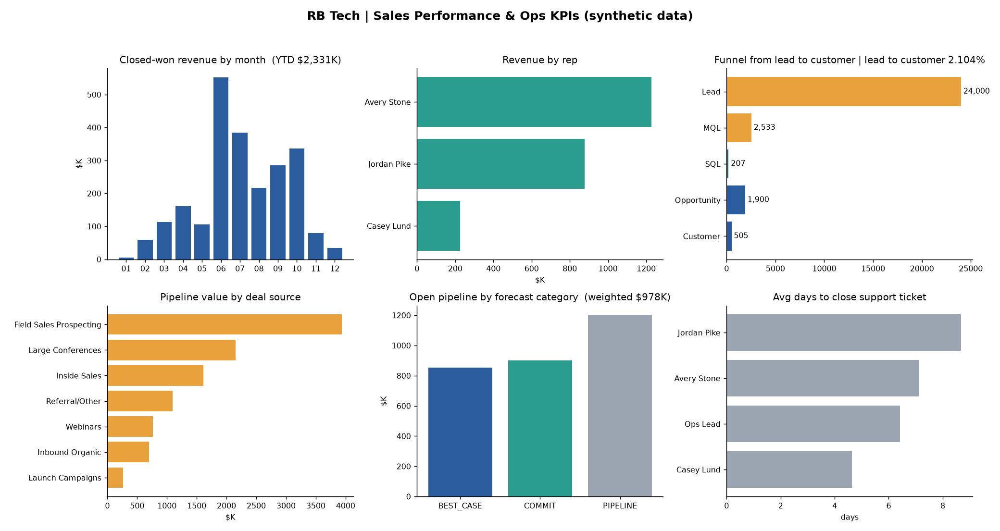
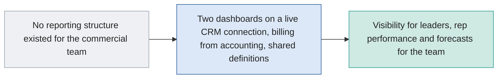
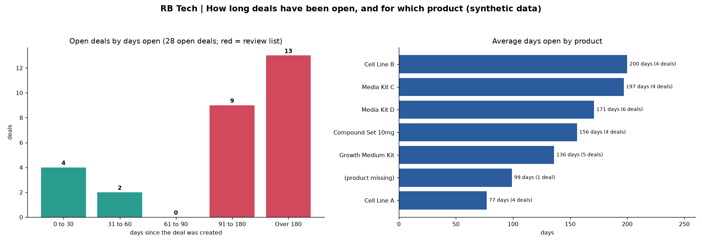
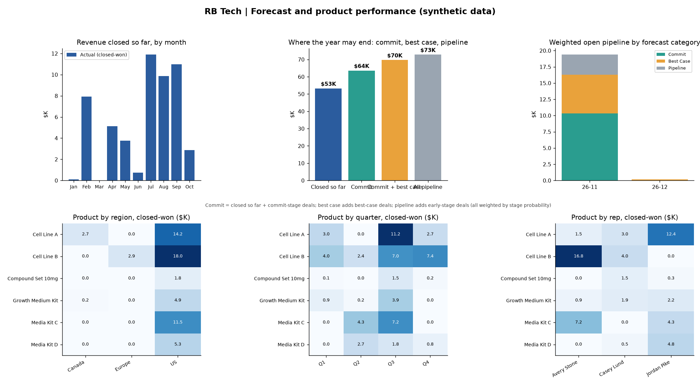

# 01 | Sales Performance & Ops KPI Dashboard

**Fictional company:** RB Tech (cell-culture and small-molecule tools) · **All data is synthetic**



## At a glance


## The story in STAR
- **Starting point:** No reporting structure existed, so I set it up from scratch. I directed a database engineer, connected the reporting tool to the CRM through its API, and defined the metrics. The dashboards use actual CRM and accounting data, so no assumptions were needed.
- **Situation:** Leaders could not see revenue, pipeline or rep activity in one place, and the commercial team could not see its own performance.
- **Task:** Create two dashboards: one for executives and team leads, to give visibility of commercial work and lift team morale, and one for the commercial team, with rep performance, deal flow and forecasting.
- **Action:** Built the executive and team-lead dashboard and a 12-page team dashboard, showed billing from the accounting system next to the raw deal value (excluding tax and shipping), added a sales funnel page, a deal-age view by product and commit, best-case and pipeline forecasts, cleaned the queries, and added two CRM failover dashboards.
- **Result:** Leaders get one trusted view, the team sees its own rep performance and forecast every week, and reporting continues even when the reporting tool is down.

## The problem
The commercial team had no reporting structure. Revenue, pipeline and rep activity sat inside the CRM and the accounting system with nothing joining them. Executives wanted revenue, pipeline and forecast on one page; the team wanted weekly activity, data-quality flags and follow-up gaps. Billing numbers come from the accounting system, while the CRM holds the raw deal value (excluding tax and shipping), so the two are shown side by side and clearly labelled.

## What I built
I directed a database engineer and connected the reporting tool to the CRM through its API, then designed two dashboards on one set of definitions.

| Dashboard | Audience | Cadence | What it shows |
|---|---|---|---|
| Executive and team-lead dashboard | Executives and team leads | Monthly | Billed revenue from the accounting system next to raw deal value (excluding tax and shipping), revenue by month, quarter, region and product, opportunity generation and contact growth. It gives leaders visibility of commercial work and lifts team morale |
| Sales Performance & Ops KPIs (team dashboard, 12 pages) | Commercial team | Weekly | This-week revenue and orders by rep; free samples by rep; revenue by customer and by rep; new deals by rep and pipeline; open-deal projections; sales and product forecast by category; activity (new contacts, sales emails, tasks); support and voice-of-customer tickets by rep; expired deals and tasks; open deals with age and product; the sales funnel; and an inside-sales tracker |

**Sales funnel pages:** contact lifecycle distribution (Lead, MQL, SQL at contact level; Opportunity and Customer at deal level), the live funnel for the current year, quarterly funnel entries and conversion rates, and an inside-sales sequence funnel. See [the funnel and its factors](../11-pipeline-health-analysis/docs/sales_funnel_and_factors.md).

## Open deal age by product


Every open deal shows how many days it has been open and which product it carries. In the synthetic data, 22 of 28 open deals are more than 90 days old, which turns the chart into an audit list: the owners review each one in the weekly meeting and either move it forward or close it. The product view shows which products carry the oldest deals.

## Forecast and product views (page 2)


| View | What it answers |
|---|---|
| Revenue closed so far, by month | What have we closed this year |
| Where the year may end: commit, best case, pipeline | What leadership can expect at year end under three simple scenarios |
| Weighted open pipeline by forecast category | How much of the forecast is commit, best case or early pipeline |
| Product by region, by quarter and by rep (heatmaps) | Which products sell where, when and through whom, so gaps and concentration are visible |

**Forecast method:** commit = closed so far plus commit-stage deals; best case adds best-case deals; pipeline adds early-stage deals, each weighted by its stage probability. Overdue open deals roll into the next month and are flagged for the owner.

## Design decisions
1. **One definition per metric** (see [docs/kpi_definitions.md](docs/kpi_definitions.md)). Every visual states its data source and filter.
2. **Two revenue views, labelled.** CRM closed-won shows the sales view; accounting invoices show the billed view (adds shipping and tax). A note on the page explains why they differ.
3. **Forecast categories carry probabilities** (Pipeline 15%, Best case 30%, Commit 60%, Closed won 100%), so the weighted forecast is explainable.
4. **Data-quality pages are first-class.** Deals missing a product, company or close date, expired deals, and overdue tasks are reported by rep so owners fix their own records.
5. **Funnel built from stage-entry dates**, not current stage, so quarterly conversion is comparable over time.

## Resilience
- **Faster refresh:** the BI queries were cleaned up (unused columns and tables removed, filters applied at the source, one shared date table), so the model refreshes in a fraction of its earlier time.
- **Scope grew with demand:** the report started as a planned 4 visuals on 1 page and grew to 15 visuals across 5 pages (revenue, pipeline, orders, customers, operations) as teams asked for more.
- **Failover dashboards:** two native CRM dashboards, one for executives and one for internal KPIs, serve the key numbers when the BI tool is down or refreshing, so leadership is never without a view.
- **Rule:** each failover dashboard uses the same definitions as the main report, and the KPI dictionary in [project 16](../16-goals-raci-and-kpi-dictionary) names the source of each number. Details: [docs/resilience.md](docs/resilience.md).

## Diagrams
- [Data flow: sources to dashboards](diagrams/data_flow.md)
- [Funnel and lead lifecycle](diagrams/funnel_lifecycle.md)
- [Weekly reporting process](diagrams/reporting_process.md)

## Reproduce it
```bash
pip install pandas numpy matplotlib
python scripts/generate_data.py      # writes data/*.csv and charts/dashboard_overview.png
```

| File | What it is |
|---|---|
| `data/leads.csv` | 24,000 contacts with source, segment, region, score, lifecycle stage |
| `data/deals.csv` | 130 deals across three pipelines with stage, forecast category, cycle days |
| `data/closed_won.csv` | Won revenue deals with month and quarter |
| `data/tickets.csv` | 180 support tickets with category and days to close |
| `data/weekly_activity.csv` | Emails, contacts added, tasks and meetings by rep and week |
| `data/kpi_summary.csv` | Headline KPIs calculated from the above |

## Skills shown
KPI framework design · funnel and lead-lifecycle modelling · forecast methodology · BI dashboard design · CRM data quality · Python data generation · stakeholder reporting
