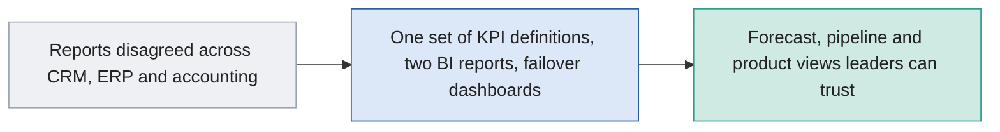

# 01 | Sales Performance & Ops KPI Dashboard

**Fictional company:** RB Tech (cell-culture and small-molecule tools) · **All data is synthetic**


## At a glance


## The story in STAR
- **Starting point:** Built from scratch: there was no usable history, so the first version rests on stated assumptions, each one labelled and replaced by actual data as it builds up.
- **Situation:** Executives and the team wanted different views, and CRM, ERP and accounting numbers disagreed.
- **Task:** Give leaders one trusted set of reports, with a forecast, that keeps working when the reporting tool is down.
- **Action:** Built two BI reports on one set of KPI definitions, labelled the two revenue views (CRM closed-won and invoiced), cleaned the queries, grew the report from 1 page to 5, and added two CRM failover dashboards plus commit, best-case and pipeline scenarios.
- **Result:** One version of every number, a forecast leaders can read in seconds, and reporting that continues during an outage.

## The problem
Leadership and the commercial team each wanted a different view: executives wanted revenue, pipeline and forecast on one page; the team wanted weekly activity, data-quality flags and follow-up gaps. Numbers lived in the CRM, the ERP and accounting, so reports disagreed.

## What I built
Two Power BI reports fed from the CRM, with one shared set of definitions:

| Report | Audience | Cadence | Pages |
|---|---|---|---|
| Sales Performance & Ops KPIs | Commercial team and executives | Weekly | This-week orders and revenue by rep, new deals, YTD revenue by customer and rep, deal flow by pipeline, forecast by category, support tickets, expired deals and tasks, contact lifecycle and funnel |
| Sales Reporting Dashboard | Executives | Monthly | Closed-won vs invoiced revenue, revenue by month, quarter, region and product, opportunity generation, contact growth |

## Forecast and product views (page 2)


| View | What it answers |
|---|---|
| Revenue closed so far, by month | What have we closed this year |
| Where the year may end: commit, best case, pipeline | What leadership can expect at year end under three simple scenarios |
| Weighted open pipeline by forecast category | How much of the forecast is commit, best case or early pipeline |
| Product by region, by quarter and by rep (heatmaps) | Which products sell where, when and through whom, so gaps and concentration are visible |

**Forecast method:** commit = closed so far plus commit-stage deals; best case adds best-case deals; pipeline adds early-stage deals, each weighted by its stage probability. Overdue open deals roll into the next month and are flagged for the owner.

## Design decisions
1. **One definition per metric** (see [docs/kpi_definitions.md](docs/kpi_definitions.md)). Every visual states its data source and filter.
2. **Two revenue views, labelled.** CRM closed-won shows the sales view; accounting invoices show the billed view (adds shipping and tax). A note on the page explains why they differ.
3. **Forecast categories carry probabilities** (Pipeline 15%, Best case 30%, Commit 60%, Closed won 100%), so the weighted forecast is explainable.
4. **Data-quality pages are first-class.** Deals missing a product, company or close date, expired deals, and overdue tasks are reported by rep so owners fix their own records.
5. **Funnel built from stage-entry dates**, not current stage, so quarterly conversion is comparable over time.

## Resilience
- **Faster refresh:** the BI queries were cleaned up (unused columns and tables removed, filters applied at the source, one shared date table), so the model refreshes in a fraction of its earlier time.
- **Scope grew with demand:** the report started as a planned 4 visuals on 1 page and grew to 15 visuals across 5 pages (revenue, pipeline, orders, customers, operations) as teams asked for more.
- **Failover dashboards:** two native CRM dashboards, one for executives and one for internal KPIs, serve the key numbers when the BI tool is down or refreshing, so leadership is never without a view.
- **Rule:** each failover dashboard uses the same definitions as the main report, and the KPI dictionary in [project 16](../16-goals-raci-and-kpi-dictionary) names the source of each number. Details: [docs/resilience.md](docs/resilience.md).

## Diagrams
- [Data flow: sources to dashboards](diagrams/data_flow.md)
- [Funnel and lead lifecycle](diagrams/funnel_lifecycle.md)
- [Weekly reporting process](diagrams/reporting_process.md)

## Reproduce it
```bash
pip install pandas numpy matplotlib
python scripts/generate_data.py      # writes data/*.csv and charts/dashboard_overview.png
```

| File | What it is |
|---|---|
| `data/leads.csv` | 24,000 contacts with source, segment, region, score, lifecycle stage |
| `data/deals.csv` | 130 deals across three pipelines with stage, forecast category, cycle days |
| `data/closed_won.csv` | Won revenue deals with month and quarter |
| `data/tickets.csv` | 180 support tickets with category and days to close |
| `data/weekly_activity.csv` | Emails, contacts added, tasks and meetings by rep and week |
| `data/kpi_summary.csv` | Headline KPIs calculated from the above |

## Skills shown
KPI framework design · funnel and lead-lifecycle modelling · forecast methodology · BI dashboard design · CRM data quality · Python data generation · stakeholder reporting
