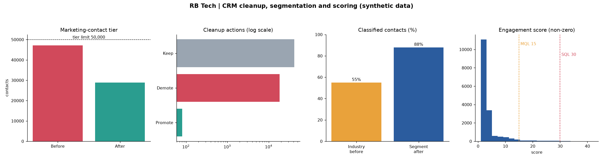
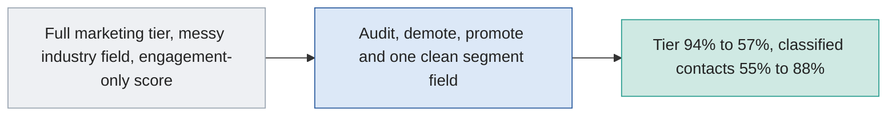

# 02 | CRM Cleanup, Segmentation and Lead Scoring

**Fictional company:** RB Tech · **All data is synthetic**



## At a glance


## The story in STAR
- **Starting point:** Built from scratch: there was no usable history, so the first version rests on stated assumptions, each one labelled and replaced by actual data as it builds up.
- **Situation:** The CRM had grown through bulk imports: the marketing tier was 94% full, three in four contacts never opened an email, and half had no industry.
- **Task:** Free up tier capacity, give every contact a clean segment, and fix the starting lead score.
- **Action:** Audited the tier, demoted 4,306 inactive contacts without deleting anyone, promoted engaged ones, created one 10-value Segment field, and wrote the entry rules.
- **Result:** Tier usage fell from 94% to 57%, classified contacts rose from 55% to 88%, and every change is reversible.

## The problem
The CRM had grown through bulk list imports. The marketing-contact tier was close to its paid limit, three out of four contacts had never opened a marketing email, nearly half had no industry, and the industry field held many overlapping values with no way to report by market. Lead score measured engagement only, so it could not tell a real buyer from a curious bystander. There was no room to nurture good leads because the tier was full of dead weight.

## What I built
Four connected pieces, each with written rules so the work is repeatable and explainable.

| Piece | What it does |
|---|---|
| **Marketing-tier audit and cleanup** | Finds contacts that cost money but never engage and moves them to non-marketing, without deleting anything |
| **Promotion list** | Finds non-marketing contacts who engaged with sales email and promotes them, holding EU/UK/CH contacts for a consent check |
| **Segment field** | Replaces a messy industry picklist with one clean Segment field using 10 market segments, filled from a mapping table and then job-title rules |
| **Engagement score with decay** | The starting point: scores replies, sales clicks and opens, decaying 20% per quarter so old activity stops counting. Its limits, and the replacement that adds fit and intent, are covered in [GTM-Strategy 02](https://github.com/rbanola1/GTM-Strategy/tree/main/02-lead-scoring-redesign) |

## Results on the synthetic CRM (14,000 contacts)
| Metric | Before | After |
|---|---|---|
| Marketing-contact tier (limit 11,600) | 10,951 (94%) | 6,663 (57%) |
| Contacts demoted to non-marketing | | 4,306 |
| Engaged contacts promoted | | 18 (plus 7 held for EU/UK/CH consent check) |
| Duplicates merged | | 22 |
| Contacts with a usable industry or segment | 55% | 88% |
| Distinct industry values | 18 | 10 segments |

The numbers are simulated. The design is the point: rules first, a reversible change log second, and nothing deleted.

## Principles
1. **Rules before action.** Every demotion and promotion follows a written rule that a colleague can audit.
2. **Reversible.** Contacts move between marketing and non-marketing; nothing is deleted. The change log lists every record touched.
3. **Protect what matters.** Customers, open deals, target personas, recent contacts and anyone added by a person on purpose are never demoted.
4. **Consent first.** EU, UK and Swiss contacts are never promoted automatically.
5. **Fix the cause.** Entry rules decide who may become a marketing contact in future, so the tier does not refill with imports.

## Documents and diagrams
- [docs/cleanup_rules.md](docs/cleanup_rules.md): demote, promote, protect and entry rules
- [docs/segmentation_model.md](docs/segmentation_model.md): the 10 segments, mapping table and title fallbacks
- [docs/lifecycle_and_scoring.md](docs/lifecycle_and_scoring.md): lifecycle stages, score weights and decay
- [docs/crm_entry_standards.md](docs/crm_entry_standards.md): entry order, lifecycle and lead status, associations, data upkeep checklist, new user onboarding
- [diagrams/cleanup_process.md](diagrams/cleanup_process.md): audit to change log
- [diagrams/segmentation_flow.md](diagrams/segmentation_flow.md): messy industry to clean segment
- [diagrams/governance.md](diagrams/governance.md): who may enter and leave the marketing tier

## Reproduce
```bash
pip install pandas numpy matplotlib
python scripts/crm_cleanup.py     # writes data/*.csv and charts/cleanup_overview.png
```

| File | What it is |
|---|---|
| `data/contacts_sample.csv` | 1,000-contact sample with action, segment, segment source, score (the script writes the full 14,000 to `contacts_cleaned.csv`) |
| `data/change_log_sample.csv` | 500-row sample of the change log (the full log is `change_log.csv`) |
| `data/industry_to_segment_map.csv` | The mapping table |
| `data/kpi_summary.csv` | Headline numbers above |

## Skills shown
CRM data governance · database audit and hygiene · segmentation design · lead scoring and lifecycle design · consent-aware marketing operations · change control · Python data work
