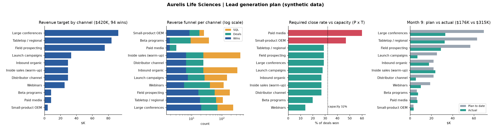

# 03 | Lead Generation Plan: Reverse-Funnel Revenue Model

**Fictional company:** Aurelis Life Sciences · **All data is synthetic**



## The problem
The business wanted a revenue number for the year and needed to know what lead generation it would take to hit it. Typical plans start from marketing activity ("we will run N events and send M emails") and hope it adds up. I planned the other way round: start from the revenue target and work backwards to the leads, meetings and activities each channel must produce, then test whether the plan is believable.

## Method
1. **Target and order size.** Revenue target divided by average order value gives the number of wins needed ($420K at $4,500 is about 94 wins at the standard order size).
2. **Allocate by channel.** Each channel gets a share of revenue based on how it has performed: conferences, tabletop and regional shows, field prospecting, webinars, launch campaigns, inbound, distributors, inside sales, paid media, beta programs, and small-product OEM.
3. **Work backwards per channel.** Wins, divided by the channel's win rate, gives deals; divided by its SQL-to-deal rate gives SQLs; divided by its MQL-to-SQL rate gives MQLs ([docs/method.md](docs/method.md)).
4. **Validate.** A team can only close so many qualified deals. A capacity ceiling (portfolio multiplier x trust factor, here 0.8 x 0.4 = 32%) caps the close rate any channel is allowed to assume. Any channel above it is flagged.
5. **Add repeat purchasers.** Assume a few constant repeat accounts (distributors) and that a share of other customers reorder, so the plan needs fewer unique new customers than wins.
6. **Track plan against actual** each month and re-forecast.
7. **Stress-test.** Re-run with lower close rates to see the revenue gap.

## Results on the synthetic run
| Item | Value |
|---|---|
| Revenue target | $420,000 |
| Wins needed | 94 at standard order size (about 101 including low-value OEM orders) |
| Unique new customers needed | about 78 (after repeat purchasers) |
| Channels within capacity | 9 of 11 (paid media and small-product OEM flagged: their close rates rest on a different, narrow buyer set) |
| Month 9 actual vs plan to date | $176K vs $315K, a run-rate of about $235K for the year |
| If close rates run 15% below plan | revenue gap of about $63K |
| If close rates run 30% below plan | revenue gap of about $126K |

Lowest cost per win: small-product OEM, distributors, inbound and field prospecting. Highest: paid media, large conferences and inside sales, each with a clear role (awareness, relationships, warm-up) beyond direct cost.

## What the plan teaches
- **MQL volume is a poor planning currency for low-intent channels.** Launch campaigns and inside-sales warm-up needed tens of thousands of MQLs to yield a handful of wins, a sign that engagement-based MQL counts say little about buying. Plan on SQLs and deals, and define MQL from fit and intent ([see the lead scoring redesign](https://github.com/rbanola1/GTM-Strategy)).
- **Capacity checks keep targets honest.** If a channel needs a close rate above what the team can do, the plan is fiction until the inputs change.
- **Plan versus actual shows which channels drive the gap.** In the synthetic run, the largest gaps are in conferences, tabletop shows and field prospecting, the biggest bets.
- **Channels with a slow ramp (distributors) need a different timing assumption**, not the same monthly phasing as events.

## Documents and diagrams
- [docs/method.md](docs/method.md): formulas, assumptions, capacity logic
- [docs/review_cadence.md](docs/review_cadence.md): monthly plan-versus-actual routine
- [diagrams/reverse_funnel.md](diagrams/reverse_funnel.md)

## Reproduce
```bash
pip install pandas numpy matplotlib
python scripts/lead_gen_plan.py    # writes data/*.csv and charts/lead_gen_plan.png
```

## Skills shown
Revenue planning · reverse-funnel modelling · channel ROI and cost per win · capacity-based validation · plan-versus-actual reporting · sensitivity analysis · Python
