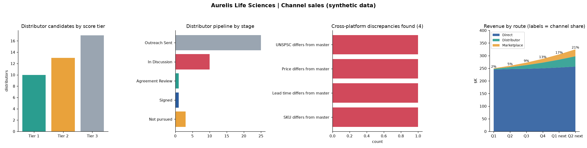

# 04 | Channel Sales: Distributors and B2B Marketplaces

**Fictional company:** Aurelis Life Sciences · **All data is synthetic**



## The problem
Revenue came almost entirely from direct sales. International customers were hard to serve (cold-chain shipping and import rules), and university and government buyers increasingly purchase through procurement platforms instead of buying from individual suppliers. The goal was to build a second route to market so that about a fifth of revenue flows through channel partners within roughly six quarters.

## What I built
| Piece | What it does |
|---|---|
| **Distributor scorecard** | Scores candidates on cold-chain capability, warehouse, reach, portfolio fit and financial health; subtracts for competitor overlap; knocks out anyone exclusive to a competitor; sorts into tiers |
| **Outreach funnel** | Tier-first outreach with one decision-maker per partner, tracked from Outreach Sent to In Discussion, Agreement Review and Signed |
| **Product master and platform feeds** | One master product sheet is the single source of truth; each platform gets its own feed in its own format (units, code lengths, text limits). Example platforms (fictional): LabBazaar (research marketplace), ProcureLink (procurement network), GovLab Supply (government purchasing), AssayExchange (services and products exchange) |
| **Cross-platform discrepancy check** | Compares every platform feed to the master and flags a different SKU, price, classification code or lead time for the same product, and finds duplicate listings of one product under two SKUs |
| **Channel economics** | Compares contribution margin by route to market and models channel share over six quarters |

## Key design decisions
1. **Score before outreach.** A weighted scorecard ([docs/distributor_scorecard.md](docs/distributor_scorecard.md)) ranks candidates so the first emails go to the best fits. Hard knockouts avoid wasted effort on partners locked to competitors.
2. **One decision-maker per partner** plus at most one escalation contact. No staff dumps.
3. **One master, many feeds.** Marketplace data is generated from the master, never typed twice ([docs/platform_onboarding.md](docs/platform_onboarding.md)).
4. **Read each platform's guide first.** Formats differ (6-digit vs 8-digit classification codes, unit codes, text limits), so each feed applies platform rules at export while the master keeps the full detail.
5. **Never touch fields owned by another team** (customs and classification codes) unless asked; flag discrepancies instead.
6. **Channel margin is lower per unit but cheaper to serve.** See [docs/channel_economics.md](docs/channel_economics.md).

## Results on the synthetic run
| Metric | Value |
|---|---|
| Distributor candidates scored | 40 (10 Tier 1, 13 Tier 2, 17 Tier 3) |
| Pipeline | 25 contacted, 10 in discussion, 1 in agreement review, 1 signed, 3 not pursued (competitor-exclusive) |
| Product master | 36 SKUs fed to 4 platform formats (LabBazaar, ProcureLink, GovLab Supply, AssayExchange) |
| Discrepancies caught | 5 (SKU, price, classification code, lead time, duplicate listing), each traced to a platform and a SKU |
| Channel share plan | 2% to 21% of revenue over six quarters (60% distributors, 40% marketplaces) |

## Diagrams and documents
- [diagrams/channel_strategy.md](diagrams/channel_strategy.md): routes to market and who serves whom
- [diagrams/distributor_pipeline.md](diagrams/distributor_pipeline.md): selection to signed agreement
- [diagrams/platform_onboarding.md](diagrams/platform_onboarding.md): master to feeds to discrepancy check
- [docs/distributor_scorecard.md](docs/distributor_scorecard.md) · [docs/platform_onboarding.md](docs/platform_onboarding.md) · [docs/channel_economics.md](docs/channel_economics.md)

## Reproduce
```bash
pip install pandas numpy matplotlib
python scripts/channel_model.py    # writes data/*.csv, data/platform_exports/*.csv, charts/channel_overview.png
```

## Related projects
- Partner onboarding steps, scorecard and the master pricing sheet standard are in [project 14](../14-partner-onboarding-and-pricing-governance). This project covers channel economics, marketplace feeds and the duplicate-listing check.

## Skills shown
Channel strategy · partner selection and onboarding · distributor and marketplace programs · product data governance · multi-platform data QA · channel economics and forecasting · Python
