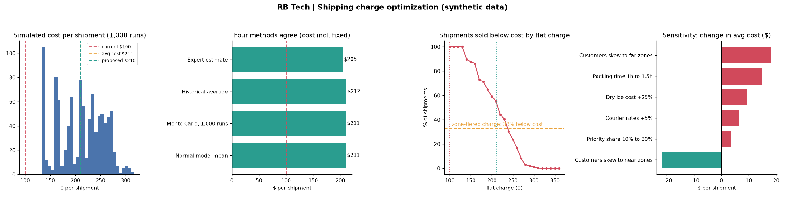
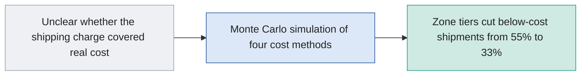

# 05 | Shipping Cost Optimization: Simulation-Led Pricing

**Fictional company:** RB Tech · **All data is synthetic** · Excel-style Monte Carlo rebuilt in Python



## At a glance


## The problem
Temperature-controlled orders shipped overnight with dry ice cost far more to deliver than the flat shipping charge customers paid. Nobody knew by how much, because cost depended on destination zone and service level, and the data was thin. Raising the charge risked competitiveness; leaving it risked margin on every order.

## Approach: four methods, one decision
Instead of trusting one number, I triangulated the answer four ways and checked that they agreed.

| Method | What it is | Avg cost per shipment (incl. fixed costs) |
|---|---|---|
| 1. Expert estimate | Operations lead's judgement from experience | $205 |
| 2. Historical average | 180 past shipments | $212 |
| 3. Monte Carlo | 1,000 simulated shipments with random zone and service level | $211 |
| 4. Statistical model | Normal-distribution fit to the simulated costs | $211 |

All four land within about $7 of each other, which gives confidence in a break-even near **$210** against the **$100** charged today.

## What the simulation shows
- Every simulated shipment at a $100 charge loses money (average loss about $111).
- A flat $210 charge breaks even on average, but because cost varies by zone, **55%** of shipments are still sold below cost.
- A **zone-tiered charge** ($165 near zones, $215 mid, $255 far) lifts the average charge slightly and cuts below-cost shipments to **33%**.
- **Sensitivity:** if customers skew toward far zones, average cost rises about $18; if packing time slips by half an hour, about $15; dry ice up 25%, about $10. Packing time and destination mix move the answer more than the courier's rate increase does.

## Recommendation (as presented)
1. Raise the flat charge from $100 to about $210 as the minimum fix.
2. Move to zone-tiered pricing to cover far destinations without overcharging near ones.
3. Track destination mix and packing time monthly, and re-run the simulation each quarter or when the courier announces a rate change.

## How the model works
- **Cost of goods per shipment:** box, dry ice, packing labor (fixed per box).
- **Courier cost:** rate by destination zone, a priority premium for faster service, and small random surcharge noise.
- **Assumptions:** fixed package weight and size (fits up to three kits), domestic only, equal probability of each zone as a baseline, 90% standard and 10% priority service.
- **Simulation:** 1,000 draws of zone and service; cost per draw; charge-versus-margin curve over a range of flat charges.

## Documents and diagrams
- [docs/methodology.md](docs/methodology.md): assumptions, limits and next steps
- [diagrams/decision_flow.md](diagrams/decision_flow.md): from question to recommendation
- [diagrams/cost_model.md](diagrams/cost_model.md): what makes up one shipment's cost

## Reproduce
```bash
pip install pandas numpy matplotlib
python scripts/shipping_simulation.py   # writes data/*.csv and charts/shipping_overview.png
```

| File | What it is |
|---|---|
| `data/simulation_1000_runs.csv` | The 1,000 simulated shipments |
| `data/historical_shipments.csv` | The 180-shipment historical sample |
| `data/method_comparison.csv` | The four estimates side by side |
| `data/charge_vs_margin.csv` | Average margin and % below cost at each flat charge |
| `data/sensitivity.csv` | Effect of each scenario on average cost |

## Skills shown
Pricing and margin analysis · Monte Carlo simulation · statistical modelling · scenario and sensitivity analysis · cost-to-serve analysis · executive recommendation writing · Excel-to-Python modelling
