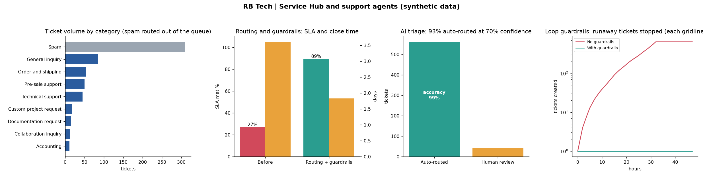
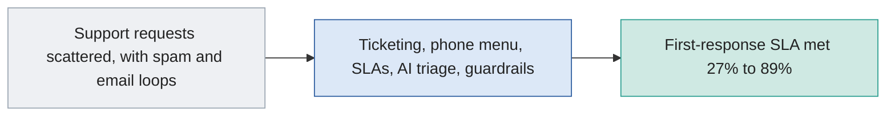

# 06 | Service Hub: Ticketing, Phone Lines and AI Support Agents

**Fictional company:** RB Tech · **All data is synthetic** · Fictional phone numbers and addresses throughout



## At a glance


## The problem
Customer questions arrived through shared inboxes, a website form, and phone calls, with no single place to see them, no owner per request type, no response-time targets, and no consistent way to handle product complaints, refunds and replacements. Half of inbound email was spam. A support request could sit unanswered for days, and a product issue might never reach the people who needed to know.

## What I built
A service desk on the CRM's service hub, covering every channel, with rules, SLAs, a phone menu, an AI triage agent and loop guardrails.

| Piece | What it does | Detail |
|---|---|---|
| **Ticket intake** | Email, website form, phone calls and manual entry all create a ticket in one support pipeline | [docs/ticketing_setup.md](docs/ticketing_setup.md) |
| **Categories and owners** | Each inquiry type has a team inbox, an owner team, a tag and an alert | [docs/ticketing_setup.md](docs/ticketing_setup.md) |
| **Workflow automations** | Eight workflows: acknowledgement email with loop guards, reply-once reset, two round-robins, spam auto-close, HR and investor routing, status changes, closed-ticket survey, plus a weekly read-only triage report | [docs/service_hub_workflows.md](docs/service_hub_workflows.md) |
| **Statuses and SLAs** | Statuses change automatically as the conversation moves; reply within 24 hours, close within 72 | [docs/ticketing_setup.md](docs/ticketing_setup.md) |
| **Refund and replacement process** | Investigate first, replace before refunding, management approval, tickets attached to the existing deal | [docs/refund_replacement_process.md](docs/refund_replacement_process.md) |
| **Phone system** | One main line with a menu that routes to reception, sales, customer service and technical support; availability synced to calendars | [docs/phone_ivr_setup.md](docs/phone_ivr_setup.md) |
| **Support pipeline vs voice-of-customer pipeline** | Product support and complaints stay in support; testimonials and field feedback go to a separate pipeline | [docs/ticketing_setup.md](docs/ticketing_setup.md) |
| **AI triage agent** | Classifies new tickets, routes the confident ones and sends the rest to a human queue | [docs/ai_support_agents.md](docs/ai_support_agents.md) |
| **Loop guardrails** | Stop an auto-reply loop between our acknowledgement email and an external helpdesk robot | [docs/incident_and_guardrails.md](docs/incident_and_guardrails.md) |
| **Satisfaction survey** | A customer effort survey sent when a support ticket closes | [docs/ticketing_setup.md](docs/ticketing_setup.md) |

## Results on the synthetic run (600 tickets)
| Metric | Before routing and guardrails | After |
|---|---|---|
| First-response SLA met (real tickets) | 27% | 89% |
| Average days to close | 3.6 | 1.8 |
| Customer effort score (1-7) | 4.9 | 5.7 |
| Tickets handled by the AI agent without a human | | 93% at 99% accuracy |
| Spam caught by the agent | | 97% |
| Tickets created by a simulated auto-reply loop over 48 hours | about 640 without guardrails | 1 with guardrails |

The numbers are simulated; the setup and rules reflect how a support desk like this is built.

## Design decisions
1. **One pipeline for support, one for voice of customer.** Mixing them makes both reports unreadable.
2. **Automatic statuses.** "Waiting on us" when the customer replies and "waiting on contact" when we do, so the queue shows what actually needs action.
3. **Owners by category, with a team inbox, personal alert and a back-up.** Nothing sits with nobody.
4. **Replace before refund.** Investigate with evidence, rule out user error, repeat the test where needed, replace from a verified lot, and refund only with management approval.
5. **Keep the closed deal closed.** Attach refund tickets to the existing deal rather than changing its stage, so revenue history stays clean.
6. **Guardrails before automation.** Any workflow that emails automatically gets loop protection and a one-per-sender-per-hour limit.
7. **Do not bulk-close tickets.** Closing fires the survey email, so mass closes spam customers.
8. **Phone routing by menu, ownership by answer.** Calls are assigned to whoever answers, and unassigned calls are reviewed daily.

## Diagrams
- [diagrams/ticket_intake.md](diagrams/ticket_intake.md) · [diagrams/ivr_tree.md](diagrams/ivr_tree.md) · [diagrams/refund_flow.md](diagrams/refund_flow.md) · [diagrams/loop_guardrails.md](diagrams/loop_guardrails.md)

## Reproduce
```bash
pip install pandas numpy matplotlib
python scripts/support_ops.py     # writes data/*.csv and charts/support_overview.png
```

## Skills shown
Service desk design · ticket taxonomy and SLAs · phone and IVR setup · workflow automation and guardrails · incident response · AI triage design · customer effort measurement · process documentation
