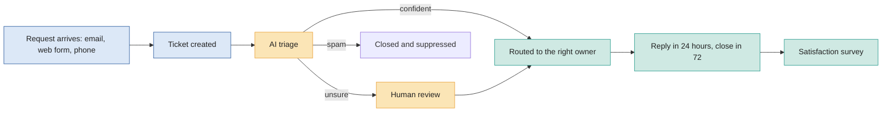

# Ticket intake and routing in seven boxes

How to read it: every request becomes one ticket, the AI sorts it, a person reviews anything it is unsure about, and each ticket reaches one owner with a reply deadline.

Full detail with every connection: [ticket_intake_full_detail.md](ticket_intake_full_detail.md).
