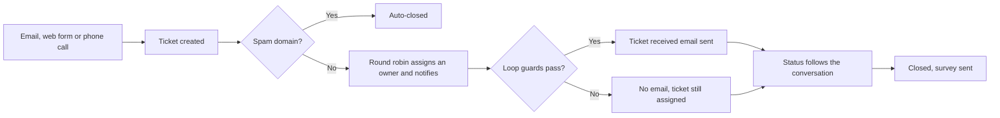
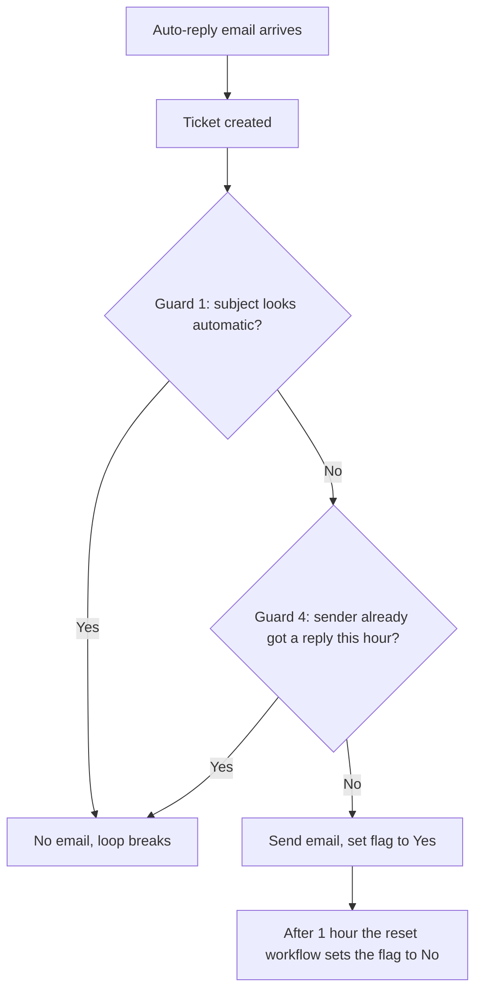

# Service hub workflow setup (as built)

The service desk runs on automations in the CRM. Each one is listed with its real workflow name, what triggers it and what it does.

| # | Workflow name | Trigger | What it does |
|---|---|---|---|
| 1 | Ticket Creation Automated Email - Guard 4 copy (live) | A ticket is created | Sends the "Ticket received" email (technical support or customer service version) to the ticket's contact, but only if the loop guards pass |
| 2 | Update Auto-reply sent status after 60 minutes | The contact checkbox "Auto-reply sent in last hour" becomes Yes | Waits one hour, then sets it back to No |
| 3 | Customer Service Round Robin | New ticket in the customer service or general categories | Assigns the ticket to the next team member and sends an assignment notification |
| 4 | Tech Support Round Robin | New ticket in technical support, including phone-created tickets | Assigns to the next team member and notifies them |
| 5 | Spam Tickets - Auto-Close Blocklisted Domains | Ticket from a blocklisted spam domain | Closes the ticket |
| 6 | HR Inquiries - Assign to owner | Ticket in the HR or investment category | Assigns it to the named person and keeps it out of the support queues |
| 7 | Support Pipeline status workflows | A customer replies, or we reply | Customer reply sets "Waiting on Us"; our reply sets "Waiting on Contact" |
| 8 | CES - Closed Ticket Survey | A Support Pipeline ticket is closed | Emails a customer effort survey |
| 9 | Friday Ticket Triage (agent, dry run) | Weekly, Friday morning | Read-only report: spam, HR and investment items, tickets needing attention, suspicious activity, same-sender bursts, loop-pattern subjects, bulk closes. Never edits tickets |
| 10 | Deal inactivity email | A catalogue or free-sample deal has no activity for 60 days | Emails the deal owner so stale deals are reviewed |
| 11 | Lifecycle workflows | New contact; deal created; deal closed-won | New contact becomes Lead; deal created makes the contact an Opportunity; closed-won makes it a Customer |

The older "Ticket Creation Automated Email" workflow is kept unpublished as a backup.

## How a ticket moves

## Loop guards inside workflow 1
| Guard | Rule | Status |
|---|---|---|
| 1. Subject exclusion | Skip the email when the ticket name contains "Ticket Created", "has been received", "Out of office", "Automatic reply" or "Undeliverable". Empty names still get the email | Live |
| 4. One automatic reply per sender per hour | Each branch checks the contact checkbox "Auto-reply sent in last hour". If Yes, no email is sent (the ticket is still created and assigned). Otherwise the box is set to Yes before the email | Live |
| Reset | Workflow 2 clears the checkbox after 60 minutes | Live |
| Survey rule | Never bulk-close tickets: each close sends a survey email | Live |
| Friday triage agent | Weekly read-only check for bursts (more than 3 tickets from one sender in 60 minutes), loop-pattern subjects, volume spikes, spam waves, stuck leads older than 7 days, bulk closes, empty or orphan tickets | Live, dry run |
| Spam and HR automations | Spam blocklist auto-close and HR routing keep running as before | Live |

## The incident that shaped the guards (details scaled)
An automatic acknowledgement from our desk reached another organisation's helpdesk robot. The robot replied automatically, the reply created a new ticket, and that ticket sent another acknowledgement, with the subject growing longer each round. A bulk close of the first wave also sent survey emails to the same helpdesk, which most likely fed a second, larger wave.
- **Cause:** acknowledgement emails answered automatically and re-ingested as new tickets.
- **Scale:** about 1,000 junk tickets in a few hours, nearly all with empty bodies; 7 genuine tickets were kept; no real request was lost.
- **Cleanup:** the junk tickets were reviewed, then deleted (restorable for 90 days) instead of closed, to avoid more surveys and keep reporting clean. The original genuine ticket was reopened and its note corrected. The sender was not blocked, so real emails still create tickets.
- **Tests:** a contact with the flag empty matched the Customer Service branch, so the email went out; the same ticket with the flag set matched no branch, so no email would go out. The test flag was cleared afterwards.

## Known limits
- A workflow cannot stop a ticket being created; it can only stop our reply that feeds a loop.
- Guard 1 depends on subject wording; Guard 4 covers any wording.
- A real customer who opens two tickets within an hour receives one acknowledgement (both tickets are still created and assigned).
- A few seconds of gap with no acknowledgement while a workflow is swapped.

## Ideas tested and dropped
- Alert on "Ticket Created" subjects: redundant with the ticket-created notification.
- Auto-close those tickets: could close a good ticket by mistake.
- Pause the survey: surveys are needed after real tickets close.
- Rolling counter of more than 3 per hour: the available edit step can only replace or clear a number and the plan has no operations add-on, so the one-reply-per-hour checkbox was used.
- Hourly monitoring agent: too costly; a weekly report is enough.
- Block the sender: rejected, real emails from that domain must still create tickets.

## If it happens again
1. Delete the junk tickets from the Tickets list (search by subject); do not bulk-close.
2. Check that the confirmation workflow and the reset workflow are both on.
3. Read the Friday report for bursts and loop-pattern subjects.
4. Do not block the sender.
