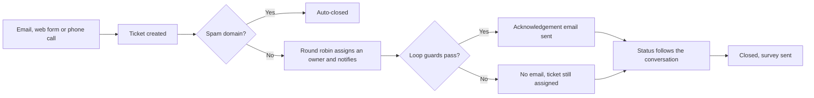

# Service hub workflow setup (the automations behind the desk)

The service desk runs on eight CRM workflows. Each one has a trigger, an action and an owner. Names are generic.

| # | Workflow | Trigger | What it does |
|---|---|---|---|
| 1 | Ticket received email | A ticket is created | Sends an acknowledgement (technical support or customer service version) to the ticket's contact, after the loop guards in workflow 2 and 3 pass |
| 2 | Reply-once reset | The contact's "auto-reply sent in the last hour" flag becomes Yes | Waits one hour, then sets the flag back to No |
| 3 | Customer service round robin | New ticket in the customer-service categories | Assigns the ticket to the next team member and sends an assignment notification |
| 4 | Technical support round robin | New ticket in the technical-support category | Assigns to the next team member and notifies them; phone-created tickets use the same rule |
| 5 | Spam auto-close | Ticket from a blocklisted domain | Closes the ticket so spam never reaches a queue |
| 6 | HR and investor inquiry routing | Ticket in the HR or investment category | Assigns it to the named person and keeps it out of the support queues |
| 7 | Status workflows | Customer replies, or we reply | Customer reply moves the ticket to "Waiting on us"; our reply moves it to "Waiting on contact" |
| 8 | Closed-ticket survey | A support ticket is closed | Emails a short customer effort survey |

A ninth item is a weekly **read-only triage report** (a dry-run agent) that lists spam, HR and investor items, tickets that need attention, same-sender bursts, loop-pattern subjects and bulk closes. It never edits tickets.

## How a ticket moves through the workflows

## Loop guardrails inside workflow 1
| Guard | Rule |
|---|---|
| Subject exclusion | Skip the acknowledgement when the ticket name contains an automatic-reply pattern such as "ticket created", "has been received", "out of office", "automatic reply" or "undeliverable" |
| One reply per sender per hour | Check the contact flag; if Yes, send nothing (the ticket is still created and assigned); if No, set it to Yes before sending |
| Reset | Workflow 2 clears the flag after an hour |
| No bulk closing | Closing many tickets at once sends many surveys; junk tickets are deleted (restorable for 90 days), not closed |
| Do not block the sender | A real customer who shares a domain with an automated helpdesk must still be able to open a ticket |

## The incident that shaped the guards (scaled)
An acknowledgement email reached another organisation's helpdesk robot. The robot replied automatically, the reply created a new ticket, and that ticket sent another acknowledgement. In a few hours the loop created about 1,000 junk tickets, almost all with empty bodies. Seven genuine tickets were kept. No real request was lost.
- **Cleanup:** the junk tickets were reviewed, then deleted instead of closed so no further survey emails went out.
- **Fix:** the two guards above plus the reset workflow, tested with one contact flagged and one not.
- **Known limits:** a workflow cannot stop a ticket from being created, only stop the reply that feeds a loop; a real customer who opens two tickets within an hour receives one acknowledgement; swapping a workflow leaves a gap of a few seconds with no acknowledgement.
- **If it happens again:** delete the junk tickets (do not bulk-close), confirm both workflows are on, read the weekly report for bursts, and do not block the sender.

## Ideas tested and dropped
- Alert on automatic-looking subjects: redundant with the existing ticket notification.
- Auto-close those tickets: could close a good ticket by mistake.
- Pause the survey: surveys are needed after real tickets close.
- Rolling counter of tickets per hour: the available edit step could only replace or clear a value, so the simple one-reply-per-hour flag was used.
- Hourly monitoring agent: too costly for the value; a weekly report is enough.
