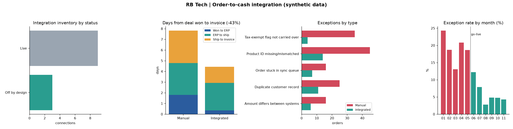
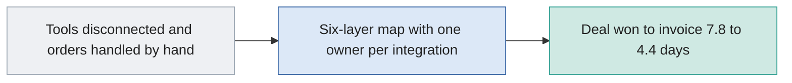
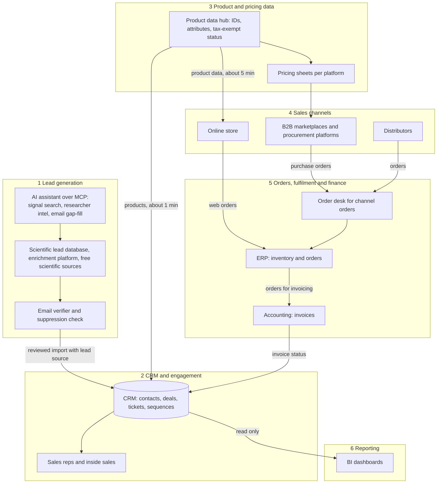

# 07 | Commercial Systems Architecture: Lead to Cash

**Fictional company:** RB Tech · **All data is synthetic**



## At a glance


## The story in STAR
- **Starting point:** Nothing existed for this yet, so I set it up from scratch.
- **Situation:** The commercial stack had grown one tool at a time, nobody could draw the whole picture, and orders were retyped two or three times.
- **Task:** Map lead-to-cash end to end and connect it with one owner and one direction per link.
- **Action:** Drew a six-layer map, wrote an integration register with a match key per connection, linked the CRM and accounting, and documented the CRM-to-reporting runbook.
- **Result:** Deal-won to invoice fell from 7.8 to 4.4 days and orders with an exception fell from 19% to 5%.

## The problem
The commercial stack had grown one tool at a time: lead sources, a CRM, a web store, an inventory system, accounting software, marketplace platforms, distributors and dashboards. Nobody could draw the whole picture. Products existed in several places with different IDs, someone re-typed each order two or three times, tax-exempt customers were billed tax, duplicate customers appeared, channel orders arrived by email and had no clear path into fulfilment, and revenue in the CRM never matched the invoices.

## What I built
One architecture, six layers, one source of truth per data object, and a register that says exactly how every system connects, in which direction, on which key, and why.



Tools behind the roles (examples): a scientific lead database queried by an AI assistant (Claude) over MCP ([project 18](../18-ai-scientific-prospecting-mcp)), CRM = HubSpot, online store = WooCommerce, ERP = Fishbowl, accounting = QuickBooks Online, BI = Power BI. The product data hub is an internal system; marketplace names are fictional.

## Layers
| Layer | What it holds | Detail |
|---|---|---|
| 1 Lead generation | Academic contact database, enrichment platform, free sources, email verifier | [docs/layers.md](docs/layers.md) |
| 2 CRM and engagement | Contacts, companies, deals, tickets, sequences, marketing email | [docs/layers.md](docs/layers.md) |
| 3 Product and pricing data | Product master, tax-exempt status, per-platform pricing sheets | [docs/layers.md](docs/layers.md) |
| 4 Sales channels | Online store, B2B marketplaces and procurement platforms, distributors | [docs/layers.md](docs/layers.md) |
| 5 Orders, fulfilment and finance | ERP, order desk, accounting | [docs/layers.md](docs/layers.md) |
| 6 Reporting | Read-only dashboards | [docs/layers.md](docs/layers.md) |

## The register
12 connections, each with direction, match key and status: 9 live, 3 switched off by design ([docs/integration_register.md](docs/integration_register.md)).

## Design principles
1. **One owner per object.** Products live in the product data hub, orders in the ERP, invoices in accounting, relationships in the CRM. Everyone else reads.
2. **One direction per connection.** Two-way syncs create loops and overwrites.
3. **Match keys first.** Product ID, order number, PO number and email decide what is the same record, agreed before anything is built.
4. **Switch off redundant syncs on purpose** and record why, so nobody switches them back on by accident.
5. **Channel orders get a defined path** through an order desk with approved templates, so marketplace purchase orders and distributor orders create the same ERP order as a web order.
6. **GTM tools never write to the CRM directly.** Imports are reviewed, tagged by source, and checked against existing records first. All outbound email is sent from the CRM.
7. **Monitor exceptions, not only successes.** A monthly three-way reconciliation compares CRM, ERP and invoice totals and lists every mismatch.

## Results on the synthetic run (1,500 orders, go-live mid-June)
| Metric | Manual | Integrated |
|---|---|---|
| Days from deal won to invoice | 7.8 | 4.4 (-43%) |
| Orders with an integration exception | 18.9% | 5.1% |
| Most common exception | Product ID missing or mismatched | Product ID missing or mismatched |
| Tax-exempt flag errors | 35 orders | 4 orders |

The numbers are simulated; the structure is the point.

## Finance and CRM in one reporting layer
The accounting system and the CRM are connected so finance and customer data can be reported together: invoices and payments are matched to CRM companies and deals by one customer key, and both feed a single BI model. Revenue comes from the accounting system; pipeline and activity come from the CRM. See [docs/crm_accounting_integration.md](docs/crm_accounting_integration.md) for the field map, match rules and checks.

## CRM to BI data flow runbook
A written runbook covers how data moves from the CRM into the BI model: the owner of each step, the maintenance routine, and the points where it fails, with the symptom, the check and the fix for each. See [docs/crm_to_bi_runbook.md](docs/crm_to_bi_runbook.md).

## Documents and diagrams
- [docs/integration_register.md](docs/integration_register.md) · [docs/layers.md](docs/layers.md) · [docs/data_ownership.md](docs/data_ownership.md) · [docs/decision_log.md](docs/decision_log.md) · [docs/reconciliation_and_monitoring.md](docs/reconciliation_and_monitoring.md)
- [diagrams/system_map.md](diagrams/system_map.md) · [diagrams/order_flow.md](diagrams/order_flow.md)

## Reproduce
```bash
pip install pandas numpy matplotlib
python scripts/order_to_cash.py    # writes data/*.csv and charts/architecture_overview.png
```

## Skills shown
Systems architecture · integration design · data governance and ownership · CRM, ERP, accounting and ecommerce integration · channel order operations · reconciliation and exception monitoring · process automation · stakeholder alignment
