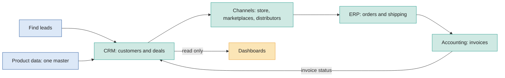

# System map: lead to cash in seven boxes

How to read it: customer and product data meet in the CRM, orders flow to the ERP and accounting, and invoice status flows back to the CRM so one reporting layer shows everything. Each arrow has one owner and one direction.

Full detail with every connection: [system_map_full_detail.md](system_map_full_detail.md).
