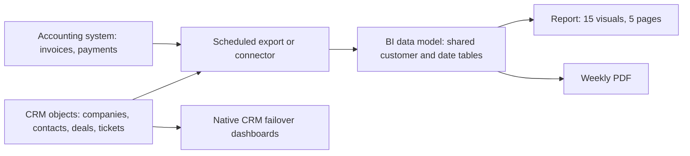

# CRM to BI data-flow runbook

## Flow

## Steps, owners and maintenance
| Step | Owner | Maintenance routine |
|---|---|---|
| CRM data entry and required fields | Sales and support | Monthly data-quality check |
| Connector and permissions | Commercial operations | Review access quarterly; rotate credentials in the password manager |
| Data model (tables, relationships, measures) | Commercial operations | Document every change; test refresh time |
| Scheduled refresh | Commercial operations | Daily outside working hours; alert on failure |
| Report and visuals | Commercial operations | Monthly review with report users |
| Failover dashboards | Commercial operations | Monthly comparison with the main report |

## Failure points
| Failure | Symptom | Check | Fix |
|---|---|---|---|
| Connector token expired | Refresh fails with an authorisation error | Connection settings page | Re-authorise; confirm the next scheduled refresh |
| CRM property renamed or deleted | A visual is blank or shows an error | Compare property list with the model | Restore the property or update the model and the dictionary |
| New picklist value | A segment or stage is missing from a chart | Check unmapped values in the model | Add the value to the mapping table |
| Duplicate customers | Revenue per customer split across two rows | Duplicate report in the CRM | Merge in the CRM, then in accounting; refresh |
| Slow refresh | Refresh time rises above its normal range | Compare with the logged baseline | Run the clean-up checklist; remove unused fields |
| BI tool outage | Report will not open | Service status page | Use the failover dashboards; tell users |
| Numbers differ between report and accounting | Monthly total does not match | Reconciliation sheet | Find the date or filter difference; correct the model |

## Rules
- Every change is recorded with the date, the reason and the person.
- The owner and a named deputy can run every step in this runbook.
- After any failure, a short note records cause, fix and prevention.
