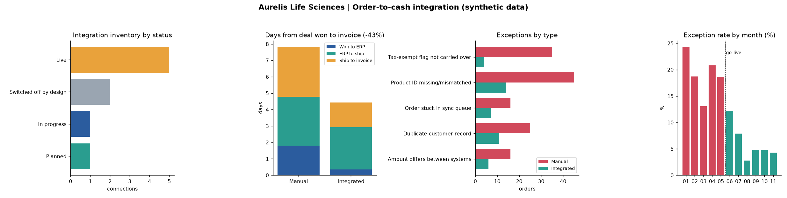
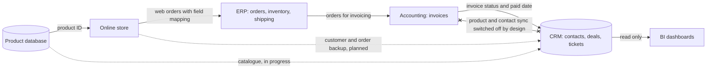

# 07 | Order-to-Cash Systems Architecture

**Fictional company:** Aurelis Life Sciences · **All data is synthetic** · **Status: In progress** (core connections live, product-catalogue sync under way)



## The problem
A deal closed in the CRM, then someone re-typed the order into the ERP, then again into accounting. Product names and IDs drifted, tax-exempt customers were billed tax, duplicate customers appeared, and revenue in the CRM never quite matched the invoices. Reports disagreed and finance and sales each kept their own version of the truth.

## What I built
A connected order-to-cash chain with one rule per data object: one system owns it, other systems receive it, and every link has a match key.



The full system map and a connection-by-connection table are in [diagrams/system_map.md](diagrams/system_map.md) and [docs/integration_inventory.md](docs/integration_inventory.md).

## Design principles
1. **One owner per object.** Products live in the product database, orders in the ERP, invoices in accounting, relationships in the CRM. Everyone else reads.
2. **Unidirectional where possible.** Two-way syncs create loops and overwrites. Each connection has one direction.
3. **Match keys first.** Product ID, order number and email decide what is the same record, agreed before anything is built.
4. **Some syncs stay off on purpose.** Turning off product and contact sync between the CRM and accounting avoided duplicates and conflicts. A switched-off sync is a decision, not a gap.
5. **Build and test next to the old process.** Field mapping is reviewed with the teams who own each system before go-live.
6. **Monitor exceptions, not only successes.** A reconciliation job compares CRM, ERP and invoice totals every month and lists every mismatch by type.

## Results on the synthetic run (1,500 orders, go-live mid-June)
| Metric | Manual | Integrated |
|---|---|---|
| Days from deal won to invoice | 7.8 | 4.4 (-43%) |
| Orders with an integration exception | 18.9% | 5.1% |
| Most common exception | Product ID missing or mismatched | Product ID missing or mismatched |
| Tax-exempt flag errors | 35 orders | 4 orders |

The numbers are simulated. The structure is the point: an inventory of connections, a data-ownership model, a reconciliation method and a decision log.

## Documents and diagrams
- [docs/integration_inventory.md](docs/integration_inventory.md): every connection, direction, key, status
- [docs/data_ownership.md](docs/data_ownership.md): who owns which object and field
- [docs/reconciliation_and_monitoring.md](docs/reconciliation_and_monitoring.md): checks, exception types, owners
- [docs/decision_log.md](docs/decision_log.md): why each sync is on, off or planned
- [diagrams/system_map.md](diagrams/system_map.md) · [diagrams/order_flow.md](diagrams/order_flow.md)

## Reproduce
```bash
pip install pandas numpy matplotlib
python scripts/order_to_cash.py    # writes data/*.csv and charts/architecture_overview.png
```

## Skills shown
Systems architecture · integration design · data governance and ownership · ERP, CRM, accounting and ecommerce integration · reconciliation and exception monitoring · process automation · stakeholder alignment
