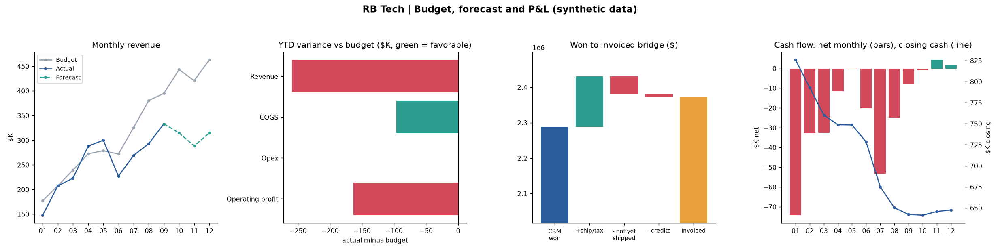
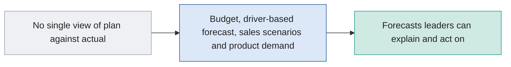
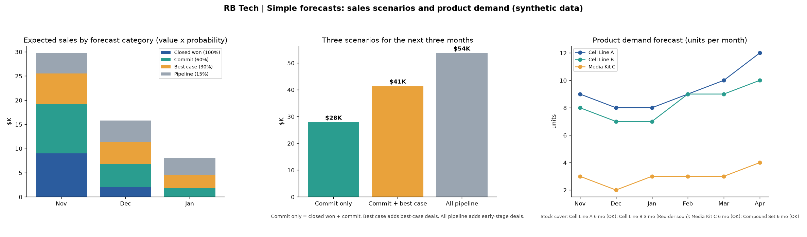

# 08 | Budgeting, Forecasting and P&L Management

**Fictional company:** RB Tech · **All data is synthetic**



## At a glance


## The story in STAR
- **Starting point:** Built from scratch: there was no usable history, so the first version rests on stated assumptions, each one labelled and replaced by actual data as it builds up.
- **Situation:** Leadership could not see plan against actual: CRM and accounting disagreed and forecasts were extrapolated from last month.
- **Task:** Give one view of budget, forecast and cash.
- **Action:** Built the budget by sales route, tracked monthly variance, built a pipeline-based forecast, reconciled CRM to invoices, and added simple scenario and product demand forecasts.
- **Result:** The year is forecast at $203K against a $245K budget, the cause (a slow distributor ramp) is visible, and operations gets reorder flags.

## The problem
Leadership needed one view of how the year was going against budget, a forecast they could trust, and cash visibility. Three things made that hard: sales numbers from the CRM did not match accounting invoices, the budget lived in spreadsheets with no variance tracking, and forecasts were extrapolated from last month rather than built from the pipeline.

## What I built
| Piece | What it does |
|---|---|
| **Budget model** | Monthly revenue by route to market (direct, distributor, marketplace) with seasonality and ramp, cost of goods by route margin, and seven operating expense lines |
| **Actual vs budget variance** | Year-to-date variance by P&L line, with favorable and unfavorable shown correctly, and operating-expense detail by line |
| **Driver-based forecast** | Actuals for completed months; remaining months blend the recent run-rate with the weighted pipeline and keep seasonality |
| **Won-to-invoiced bridge** | Reconciles CRM closed-won revenue to accounting invoices (shipping and tax billed, orders won but not yet shipped, credits and adjustments) so both teams use one number |
| **Cash-flow projection** | Collections lag by route (days sales outstanding), so channel growth shows up in cash later than in revenue |
| **Scenarios** | Pipeline converts lower or higher, shipping and COGS up, extra hiring, each with full-year revenue and operating profit |

## Results on the synthetic run (actuals Jan to Sep, forecast Oct to Dec)
Scale: a small company with a revenue plan of about $245K for the year, so the P&L is a loss-making start-up profile.

| Metric | Budget | Actual / forecast |
|---|---|---|
| YTD revenue | $161K | $145K (-10%) |
| YTD gross profit | $96K | $86K (-11%) |
| YTD operating expenses | $140K | $140K (on budget) |
| YTD operating profit | -$44K | -$54K |
| Full-year revenue | $245K | $203K forecast (-17%) |
| Full-year operating profit | -$46K | -$69K forecast |

**Why the gap:** the distributor channel ramps slower than budgeted, so revenue lags while costs stay on plan. The budget assumed the channel would contribute from midyear.
**Won to invoiced:** invoices differ from CRM closed-won because shipping and tax are billed but not in deal amounts, partly offset by orders won but not yet shipped; the bridge in the chart reconciles the two.
**Scenarios:** if the pipeline converts 15% worse, full-year operating profit drops to about -$75K; a 10% hiring increase costs about $5K more.

## Simple forecasts: sales scenarios and product demand


| Forecast | Question | How it works |
|---|---|---|
| Sales scenarios | What could the next three months bring? | Each open deal sits in a forecast category with a probability: closed won 100%, commit 60%, best case 30%, pipeline 15%. Three scenarios add one category at a time: commit only, commit plus best case, and all pipeline |
| Product demand | How many units will customers order, and when must operations reorder? | Recent monthly average, times seasonality and growth, compared with stock on hand to give months of cover and a reorder flag |

Keeping to two simple forecasts is deliberate: leaders can read a scenario in seconds, and operations gets one number per product.

## Design decisions
1. **Budget by route to market**, not just by total, so channel ramp assumptions are explicit and testable.
2. **Forecast from drivers**, not from last month: blend recent run-rate with weighted pipeline, then apply seasonality.
3. **Two revenue views, one bridge.** The sales view and the billed view are both correct for different purposes; the bridge explains the difference.
4. **Cash lags revenue.** Distributors and marketplaces pay slower than direct customers, so growth in those channels needs working-capital planning.
5. **Variance with direction.** Lower cost than budget is favorable; lower revenue is unfavorable. Charts and tables show both consistently.
6. **Scenarios for decisions**, not just reporting: what happens if conversion drops, costs rise or hiring goes ahead.

## Documents and diagrams
- [docs/budget_method.md](docs/budget_method.md) · [docs/forecast_method.md](docs/forecast_method.md) · [docs/monthly_close_and_review.md](docs/monthly_close_and_review.md)
- [diagrams/planning_cycle.md](diagrams/planning_cycle.md) · [diagrams/revenue_bridge.md](diagrams/revenue_bridge.md)

## Reproduce
```bash
pip install pandas numpy matplotlib
python scripts/forecast_scenarios_and_demand.py   # sales scenarios and product demand
python scripts/budget_forecast_pnl.py   # writes data/*.csv and charts/budget_forecast_overview.png
```

## Skills shown
Budgeting and P&L management · variance analysis · driver-based forecasting · revenue reconciliation (CRM to accounting) · cash-flow planning · scenario analysis · finance and sales alignment · Python
