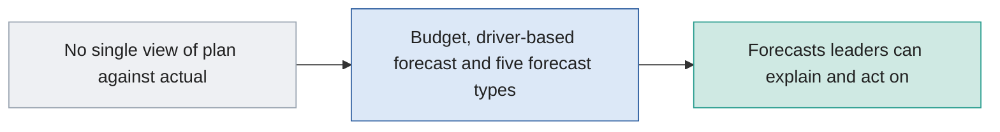
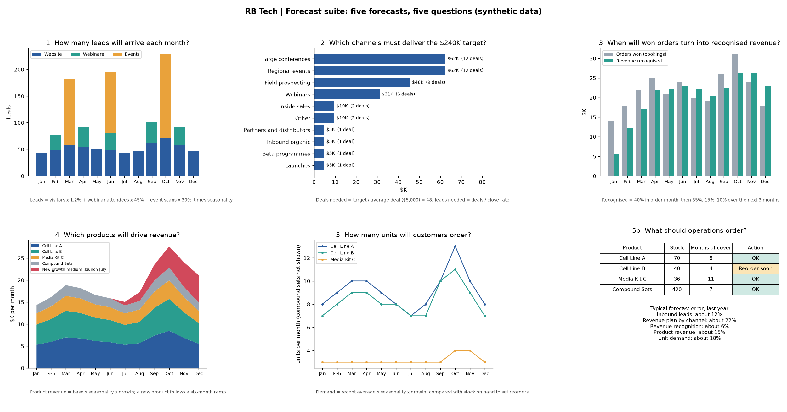

# 08 | Budgeting, Forecasting and P&L Management

**Fictional company:** RB Tech · **All data is synthetic**


## At a glance


## The problem
Leadership needed one view of how the year was going against budget, a forecast they could trust, and cash visibility. Three things made that hard: sales numbers from the CRM did not match accounting invoices, the budget lived in spreadsheets with no variance tracking, and forecasts were extrapolated from last month rather than built from the pipeline.

## What I built
| Piece | What it does |
|---|---|
| **Budget model** | Monthly revenue by route to market (direct, distributor, marketplace) with seasonality and ramp, cost of goods by route margin, and seven operating expense lines |
| **Actual vs budget variance** | Year-to-date variance by P&L line, with favorable and unfavorable shown correctly, and operating-expense detail by line |
| **Driver-based forecast** | Actuals for completed months; remaining months blend the recent run-rate with the weighted pipeline and keep seasonality |
| **Won-to-invoiced bridge** | Reconciles CRM closed-won revenue to accounting invoices (shipping and tax billed, orders won but not yet shipped, credits and adjustments) so both teams use one number |
| **Cash-flow projection** | Collections lag by route (days sales outstanding), so channel growth shows up in cash later than in revenue |
| **Scenarios** | Pipeline converts lower or higher, shipping and COGS up, extra hiring, each with full-year revenue and operating profit |

## Results on the synthetic run (actuals Jan to Sep, forecast Oct to Dec)
| Metric | Budget | Actual / forecast |
|---|---|---|
| YTD revenue | $550K | $494K (-10%) |
| YTD gross profit | $328K | $293K (-11%) |
| YTD operating expenses | $323K | $324K (on budget) |
| YTD operating profit | +$5K | -$31K |
| Full-year revenue | $836K | $694K forecast (-17%) |
| Full-year operating profit | +$52K | -$28K forecast |

**Why the gap:** the distributor channel ramps slower than budgeted, so revenue lags while costs stay on plan. The budget assumed the channel would contribute from midyear.
**Won to invoiced:** invoices exceed CRM closed-won by about 3.7% because shipping and tax are billed but not in deal amounts, partly offset by orders won but not yet shipped.
**Scenarios:** if the pipeline converts 15% worse, full-year operating profit drops to about -$46K; a 10% hiring increase costs about $11K more.

## Forecast suite: five forecasts, five questions


| Forecast | Question | Equation in one line |
|---|---|---|
| Inbound lead forecast | How many leads will arrive each month? | Visitors x rate + webinar attendees x rate + event scans x rate, times seasonality |
| Deal and revenue plan | Which channels must deliver the target? | Deals needed = target / average deal; qualified leads = deals / close rate |
| Revenue recognition forecast | When do won orders become revenue? | Recognised = share of each month's orders recognised over the following months |
| Product forecast | Which products drive revenue, including launches? | Base x price x seasonality x growth, with a launch ramp |
| Demand forecast | How many units, and what should operations order? | Recent average x seasonality x growth; reorder when months of cover run low |

Equations, inputs, owners and accuracy tracking are in [docs/forecast_types_and_equations.md](docs/forecast_types_and_equations.md).

## Design decisions
1. **Budget by route to market**, not just by total, so channel ramp assumptions are explicit and testable.
2. **Forecast from drivers**, not from last month: blend recent run-rate with weighted pipeline, then apply seasonality.
3. **Two revenue views, one bridge.** The sales view and the billed view are both correct for different purposes; the bridge explains the difference.
4. **Cash lags revenue.** Distributors and marketplaces pay slower than direct customers, so growth in those channels needs working-capital planning.
5. **Variance with direction.** Lower cost than budget is favorable; lower revenue is unfavorable. Charts and tables show both consistently.
6. **Scenarios for decisions**, not just reporting: what happens if conversion drops, costs rise or hiring goes ahead.

## Documents and diagrams
- [docs/forecast_types_and_equations.md](docs/forecast_types_and_equations.md) · [docs/budget_method.md](docs/budget_method.md) · [docs/forecast_method.md](docs/forecast_method.md) · [docs/monthly_close_and_review.md](docs/monthly_close_and_review.md)
- [diagrams/planning_cycle.md](diagrams/planning_cycle.md) · [diagrams/revenue_bridge.md](diagrams/revenue_bridge.md)

## Reproduce
```bash
pip install pandas numpy matplotlib
python scripts/forecast_suite.py          # the five forecasts
python scripts/budget_forecast_pnl.py   # writes data/*.csv and charts/budget_forecast_overview.png
```

## Skills shown
Budgeting and P&L management · variance analysis · driver-based forecasting · revenue reconciliation (CRM to accounting) · cash-flow planning · scenario analysis · finance and sales alignment · Python
