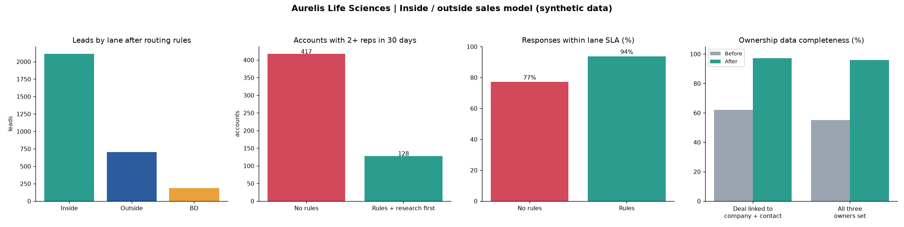

# 09 | Lead Ownership Rules and the Inside-Sales Warm-Lead Model

**Fictional company:** Aurelis Life Sciences · **All data is synthetic** · **Status: Evolved** (the original inside/outside lane split was an early design; the model moved to inside sales warming leads for reps, then to outbound and channel GTM. The ownership rules below still apply.)

> **How this evolved.** The first design split inbound work between inside and outside reps by fixed criteria. The practical model that followed was simpler: **inside sales qualifies and warms inbound leads, then hands warm leads to the reps who own the accounts.** The lane criteria below are kept as the earlier design and as a worked example of rules-based routing. The ownership and "research first" rules were the durable part. Growth later came from [outbound GTM](https://github.com/rbanola1/GTM-Strategy) and channel sales rather than from lane routing.



## The problem
As the commercial team grew in a niche market, reps started contacting the same customers: two reps emailing the same lab, different reps quoting the same project, a new division of an existing customer with no clear owner, duplicate company records, and disputes over who owned a trade-show lead. Customers got a confusing experience and the CRM could not say who owned what.

## What I built
A sales model with three parts that work together.

| Part | What it does |
|---|---|
| **Lane criteria** | Splits work between inside sales, outside sales and business development using geography, sales cycle, lead source, product category, customer type, deal size and response-time expectation ([docs/routing_criteria.md](docs/routing_criteria.md)) |
| **"Research first" rule** | Before contacting anyone, search the CRM for the company, deal and contact; if another rep owns it, get permission first ([docs/research_first_and_ownership.md](docs/research_first_and_ownership.md)) |
| **Ownership data model** | Mandatory contact, deal and company owners; deals linked to both company and contact; parent and child accounts; association labels for each contact's role ([docs/association_labels.md](docs/association_labels.md)) |

Inbound inboxes and forms also feed a **ticketing system** that assigns each request to a primary, secondary and last-resort owner by category ([docs/ticket_routing.md](docs/ticket_routing.md)).

## Results on the synthetic run (3,000 leads, 700 accounts)
The simulation models the earlier lane criteria together with the ownership rules, so the conflict and response-time effects come mainly from the ownership check and clear routing, not from the specific lane split.

| Metric | No rules | Rules + research first |
|---|---|---|
| Accounts touched by 2+ reps within 30 days | 417 | 128 |
| Responses within the lane's time limit | 77% | 94% |
| Leads by lane | | Inside 2,110, Outside 702, BD 188 |

The "ownership data completeness" panel (deals linked to company and contact, all three owners set) uses **assumed** before and after values to show the target. They are not simulated. Routing, conflicts and response times are simulated.

The residual conflicts come from accounts that had no owner yet when the first leads arrived, which is why the rules also include a default owner and a merge step.

## Design decisions
1. **Criteria, not people.** Lanes are defined by lead and account attributes so the model survives staffing changes.
2. **Ownership before outreach.** A mandatory search beats any after-the-fact cleanup.
3. **Log everything.** All emails, calls, notes, tasks and meetings are logged in the CRM, so the record settles disputes.
4. **Keep one pipeline structure.** I evaluated four separate pipelines (non-revenue, outside, inside, therapeutics and distributor) and rejected it because it multiplies training and splits one account across pipelines ([docs/decision_log.md](docs/decision_log.md)).
5. **Default owners.** Conference leads default to the outside sales manager until reassigned.
6. **Alert on overlap.** A workflow flags a new deal created in a company owned by another rep.

## Diagrams
- [diagrams/warm_lead_handoff.md](diagrams/warm_lead_handoff.md): the current model, inside sales warming leads for reps
- [diagrams/routing_flow.md](diagrams/routing_flow.md): lead to lane (earlier design)
- [diagrams/research_first_flow.md](diagrams/research_first_flow.md): the ownership check
- [diagrams/ownership_model.md](diagrams/ownership_model.md): account, contact and deal ownership

## Reproduce
```bash
pip install pandas numpy matplotlib
python scripts/lead_routing.py     # writes data/*.csv and charts/sales_model_overview.png
```

## Skills shown
Sales operations design · territory and lead management · CRM ownership model · account hierarchy design · ticket-based routing · SLA design · workflow automation · change management
