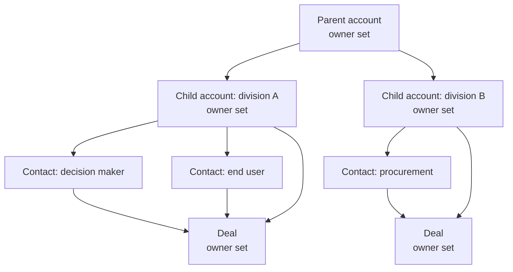

# Ownership model

Every deal is linked to both its company and a relevant contact. Every record has an owner. Child accounts roll up to the parent, so a new division of an existing customer is visible to the parent owner immediately.
