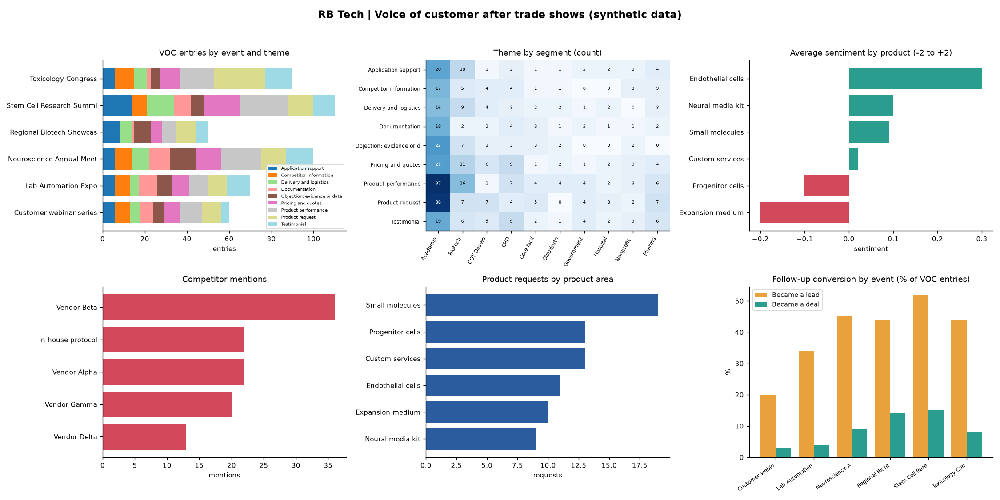

# 10 | Voice of Customer Program: Capture, Tag and Visualise After Trade Shows

**Fictional company:** RB Tech · **All data is synthetic** · No real customer comments appear here



## The problem
Customer feedback arrived in booth conversations, support tickets, surveys and emails, and stayed in people's heads and inboxes. After each trade show the team had a stack of business cards and anecdotes but no shared record, so product management could not see what customers asked for, marketing could not see which objections kept coming up, and nobody could say which events produced useful intelligence as well as leads.

## What I built
1. **One capture standard** so every comment is recorded the same way, within 48 hours of the conversation ([docs/capture_standards.md](docs/capture_standards.md)).
2. **A tagging taxonomy** of nine themes, ten customer segments, product areas, competitor mentions and a sentiment score ([docs/tagging_taxonomy.md](docs/tagging_taxonomy.md)).
3. **A post-event dashboard** that turns the entries into six views: themes by event, themes by segment, sentiment by product, competitor mentions, product requests, and follow-up conversion by event.
4. **An action loop** that sends each theme to an owner: product management, marketing, support, sales ([docs/action_loop.md](docs/action_loop.md)).

## What the synthetic data shows (480 entries, six events)
| Finding | Evidence |
|---|---|
| Academia is the loudest voice | Most entries come from academic contacts, with product performance and product requests the top themes |
| One product area is trusted, one is a problem | Endothelial cells have the best average sentiment; the expansion medium has the worst |
| One competitor dominates the conversation | One vendor is mentioned about 60% more often than the next |
| Small molecules lead the requests | Customers ask for new small-molecule products more than for any other area |
| One in three entries is negative | 34% carry negative sentiment, mostly documentation, pricing and evidence objections |
| Events differ widely in follow-up value | The stem cell summit turned 52% of entries into leads and 15% into deals; webinars turned 20% into leads and 3% into deals |
| Testimonials are available | 57 entries are testimonials, each flagged for a permission request |

## How the data is used
- **Product management** gets ranked requests by product area and the objections tied to each product.
- **Marketing** gets the objection list and testimonial candidates for messaging and case studies.
- **Sales** gets the follow-up list with each contact's stated need, within 48 hours.
- **Leadership** gets event-by-event return: leads, deals and useful intelligence per entry, to decide which shows to repeat.

## Design decisions
1. **Capture at the source, not at the end.** A short form completed at the booth or right after a ticket closes beats a weekly reconstruction.
2. **One record per comment**, with a count of associated contacts, so a theme heard from five labs is visible as such.
3. **A fixed theme list**, with a separate tag for competitor information, product requests and testimonials, so reports are comparable across events.
4. **Keep VOC separate from support.** Support tickets are for issues needing action; VOC holds field feedback and testimonials. Product complaints stay in support, and a copy of the insight goes to VOC.
5. **Sentiment on a simple five-point scale** so averages by product mean something.
6. **Close the loop.** Each theme has an owner and a response, and the owner reports back at the monthly review.

## Documents and diagrams
- [docs/capture_standards.md](docs/capture_standards.md) · [docs/tagging_taxonomy.md](docs/tagging_taxonomy.md) · [docs/post_event_process.md](docs/post_event_process.md) · [docs/action_loop.md](docs/action_loop.md)
- [diagrams/voc_loop.md](diagrams/voc_loop.md)

## Reproduce
```bash
pip install pandas numpy matplotlib
python scripts/voc_program.py    # writes data/*.csv and charts/voc_dashboard.png
```

## Skills shown
Voice-of-customer program design · feedback taxonomy and tagging · event ROI analysis · sentiment tracking · competitive intelligence · dashboard design · cross-functional action loops · Python
