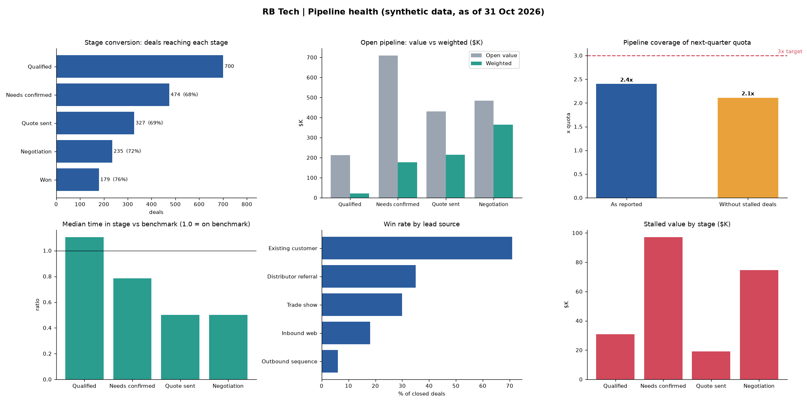
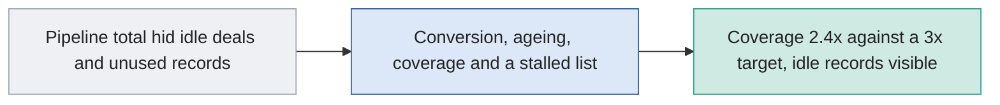
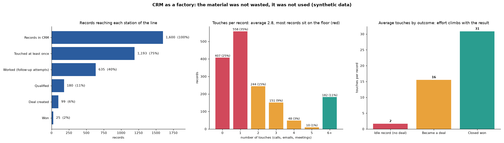

# 11 | Pipeline Health Analysis: Conversion, Ageing, Coverage and Stalled Deals

**Fictional company:** RB Tech · **All data is synthetic**



## At a glance


## The problem
The pipeline report showed one number: total open value. It said nothing about whether deals were moving, which sources produced wins, or whether next quarter's quota was actually covered. Leadership saw a healthy total while several deals had not been touched for weeks.

## What I built
A weekly pipeline-health view from CRM deal data with six measures:
1. **Stage conversion**: how many deals reach each stage, and the rate from one stage to the next.
2. **Open value versus weighted value** by stage, using stage probabilities agreed with sales.
3. **Coverage of next-quarter quota**, as reported and after removing stalled deals, against a 3x target.
4. **Time in stage versus benchmark** for each stage.
5. **Win rate by lead source**, to show where effort pays back.
6. **A stalled-deal list**: no activity for 21 days, or more than twice the benchmark time in stage, sorted by value for the weekly review.

## Sales pipeline structure (how the CRM is set up)
The weekly view sits on a defined lifecycle and four deal pipelines, written down in [docs/lifecycle_and_pipelines.md](docs/lifecycle_and_pipelines.md) and drawn in [diagrams/lifecycle_and_pipelines.md](diagrams/lifecycle_and_pipelines.md):
- **Lifecycle stages:** Lead, MQL, SQL, Opportunity, Customer. A new contact becomes a Lead automatically, a created deal makes its contact an Opportunity, and a closed-won deal makes it a Customer. MQL and SQL come from a combined score that uses **fit, intent and engagement**, not engagement alone, so the old engagement-only cut-offs of 15 and 30 no longer apply.
- **Four pipelines:** Sales, Samples (non-revenue), E-commerce and Custom project, each with its own closed-won stage, all counted in the funnel.
- **Funnel history:** Lead, MQL and SQL are counted per contact from their stage-entry dates; Opportunity and Customer are counted per deal, so a deal with several contacts is not counted several times.
- **Qualified SQL:** an SQL that a rep has contacted and verified.

## What the synthetic data shows (110 deals and 1,600 records in one year)
| Finding | Evidence |
|---|---|
| Coverage looks fine but falls short | Open pipeline of about $128K is 2.4x next-quarter quota against a 3x target; removing stalled deals drops it to 2.1x |
| The funnel leaks evenly | About 70% of deals move up at each stage; overall win rate is 29% of closed deals (26 wins) |
| Source decides the outcome | Existing customers win 85% of the time; distributor referrals 40%; trade shows 19%; outbound sequences 14%; inbound web 11% |
| Material lies on the floor | Of 1,600 records, 25% were never touched and 35% were touched once; 85% have three or fewer touches and only 11% reach six or more; effort climbs with the result: about 2 touches on an idle record, about 16 on a record that became a deal and about 31 on one that was won |
| Few records reach the end of the line | 40% worked, 11% qualified, 6% became deals, 2% were won |

## The CRM as a factory
The core problem: the CRM was full of good raw material that was lying on the floor. Records were accurate and plentiful, but most never received enough touches to move anywhere. I treated the CRM like a production line: records are raw material, stages are stations, wins are finished goods, and an idle record is inventory that was bought and never used.

In the synthetic data, 1,600 records entered the CRM in a year. A quarter were never touched, and another 35% were touched once. 85% of records had three or fewer touches, and only 11% reached six or more. The proof that touches matter: an idle record averaged about 2 touches, a record that became a deal about 16, and a closed-won record about 31. The signal is real; it was just not acted on early enough. At the end of the line, 40% were worked, 11% qualified, 6% became deals and 2% were won. Trade-show records were the most idle.



The fix was operational: every station gets an owner, a time limit and a touch target, and idle inventory raises an alert. See [diagrams/crm_factory.md](diagrams/crm_factory.md) for the before and after line.

## How the data is used
- **Weekly pipeline review:** start with the stalled list, then coverage, then new deals needed to reach 3x.
- **Lead-source planning:** the win-rate table feeds the reverse-funnel model in [project 03](../03-lead-gen-plan).
- **Forecast:** weighted pipeline by stage feeds the driver-based forecast in [project 08](../08-budget-forecast-pnl).

## Design decisions
1. **Coverage is shown twice**, with and without stalled deals, so the real gap is visible.
2. **Benchmarks come from won deals**: the median time won deals spent in each stage, not an opinion.
3. **One definition of stalled**, written down ([docs/stage_definitions.md](docs/stage_definitions.md)), so the rep, the manager and the report agree.
4. **Weighted value is a planning number**, never a promise; the forecast uses it with a range.

## Documents and diagrams
- [docs/lifecycle_and_pipelines.md](docs/lifecycle_and_pipelines.md) · [docs/stage_definitions.md](docs/stage_definitions.md) · [docs/weekly_review_routine.md](docs/weekly_review_routine.md)
- [diagrams/lifecycle_and_pipelines.md](diagrams/lifecycle_and_pipelines.md) · [diagrams/pipeline_review_flow.md](diagrams/pipeline_review_flow.md) · [diagrams/crm_factory.md](diagrams/crm_factory.md)

## Reproduce
```bash
pip install pandas numpy matplotlib
python scripts/pipeline_health.py    # writes data/*.csv and charts/pipeline_health_dashboard.png
```

## Skills shown
Pipeline analysis · stage-conversion funnels · coverage ratios · deal-ageing benchmarks · win-rate analysis by source · forecasting inputs · weekly review design · Python
