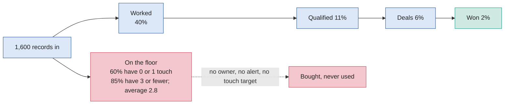
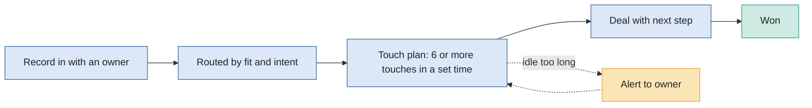

# The CRM as a factory

The problem was not bad material. The CRM held plenty of good records, but most of them were lying on the floor: never touched, or touched once, and then left. Few ever reached the conveyor.

## Before: material on the floor

## After: nothing stays on the floor

Full detail with every connection: [crm_factory_full_detail.md](crm_factory_full_detail.md).

## Factory measures used in the weekly report
| Factory term | CRM measure | Why it matters |
|---|---|---|
| Raw material | Records created by source | Shows where input comes from |
| Utilisation | Share of records touched and worked | The gap between input and use |
| Work in progress | Open deals by stage | Too much at one station means a bottleneck |
| Idle inventory | Records or deals with no activity past the benchmark | Material paid for and not used |
| Yield per station | Conversion from one stage to the next | Finds the weakest station |
| Cycle time | Days in each stage versus benchmark | Finds slow stations |
| Throughput | Deals won per month | The output that counts |
