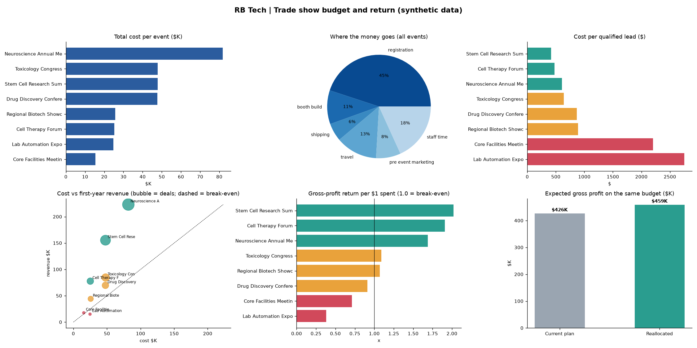

# 12 | Trade Show Budget and Return: Cost per Lead, Payback and Repeat / Change / Drop

**Fictional company:** RB Tech · **All data is synthetic**



## The problem
Trade shows were the largest marketing line and the hardest to judge. Costs sat in several places (registration, booth, shipping, travel, staff time) and results sat in the CRM. Nobody could say, for a given show, what it cost per qualified lead or whether it paid back, so shows were repeated out of habit.

## What I built
1. **A full cost model per event**: registration, booth build, shipping, travel, pre-event marketing and staff time, so the true cost is visible.
2. **A return model** that links each event to qualified leads, deals and first-year revenue, and measures return on gross profit, not revenue.
3. **A repeat / change / drop score** combining gross-profit return (50%), cost per qualified lead (30%) and audience fit (20%), with a simple rule: repeat at 1.2x or more, change between 0.8x and 1.2x, drop below 0.8x.
4. **A budget reallocation** that moves spend from the two weakest shows to the strongest, with a 30% haircut on the extra return for diminishing returns.
5. **A tie to the voice-of-customer program** ([project 10](../10-voice-of-customer-program)): the intelligence an event produces counts alongside leads when a close call comes up.

## What the synthetic data shows (eight events, $316K total)
| Finding | Evidence |
|---|---|
| Audience fit predicts return | The three best-fit shows return $1.7 to $2.0 of gross profit per $1 spent; the weakest-fit shows return $0.4 to $0.7 |
| The cheapest show is not the best | The $15K and $25K shows have the worst cost per qualified lead ($2,205 and $2,750) |
| The big show earns its cost | The largest booth returns $1.69 per $1 and the most deals |
| Registration and staff time dominate | Registration is 45% of spend and staff time is 18%, which a travel-only budget would miss |
| Reallocating helps | Moving the budget of the two weakest shows to the best three lifts expected gross profit from $426K to $459K on the same spend |

## How the data is used
- **Annual events plan:** shows are chosen from the ranking before registration deadlines.
- **Pre-show brief:** each show has a lead target, a deal target and a spend cap.
- **Post-show review:** actual results are compared with the targets within 30 days, then again at 12 months for revenue.

## Design decisions
1. **Count staff time.** It is real cost and changes the ranking of small shows.
2. **Use gross profit, not revenue**, so product margin is part of the decision.
3. **Judge at 12 months** because tools sales cycles are long; show the early view (leads) and the late view (revenue) side by side.
4. **Keep a "change" category.** A show with mixed results may need a smaller booth or a talk, not a drop.

## Documents and diagrams
- [docs/budget_template.md](docs/budget_template.md) · [docs/event_scorecard.md](docs/event_scorecard.md)
- [diagrams/event_decision_flow.md](diagrams/event_decision_flow.md)

## Added case
- **Pre-show lead list and personalised openers:** suppress, score, tier, then write a specific opener to book meetings before the show. See [docs/pre_show_lead_list_and_openers.md](docs/pre_show_lead_list_and_openers.md).

## Reproduce
```bash
pip install pandas numpy matplotlib
python scripts/tradeshow_roi.py    # writes data/*.csv and charts/tradeshow_roi_dashboard.png
```

## Skills shown
Marketing and event budgeting · cost-per-lead and payback analysis · return on gross profit · scenario and reallocation modelling · cross-functional planning · Python
