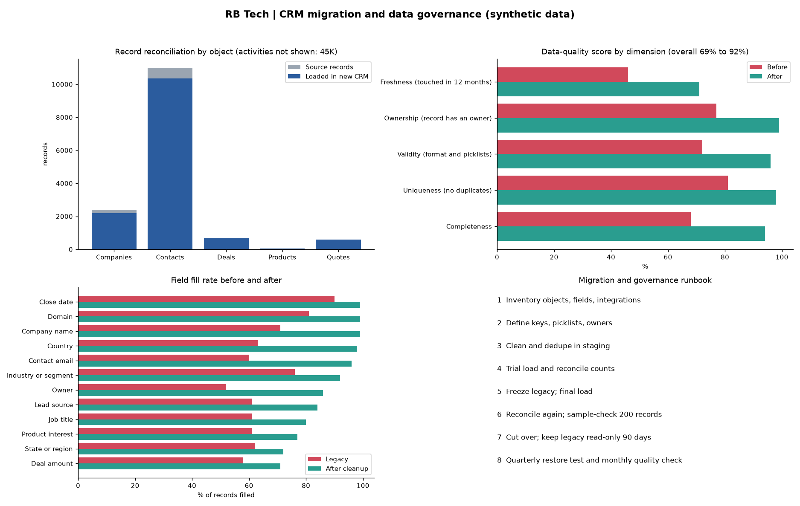
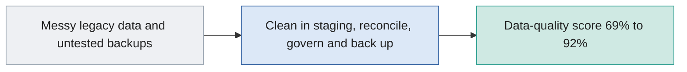

# 13 | CRM Migration, Backup and Data Governance

**Fictional company:** RB Tech · **All data is synthetic**



## At a glance


## The story in STAR
- **Starting point:** Nothing existed for this yet, so I set it up from scratch.
- **Situation:** The company was moving to a new CRM with years of duplicates and missing owners, and no tested backup.
- **Task:** Migrate cleanly, keep the data clean, and make recovery certain.
- **Action:** Cleaned in staging, reconciled counts twice, set field and ownership rules, scored data quality, tested backups and wrote password and email-logging rules.
- **Result:** Data quality rose from 69% to 92%, and 58 records lost silently in the first load were found and reloaded.

## The problem
The company was moving from a legacy CRM to a new one, and the old system held years of records with duplicates, missing owners and inconsistent fields. A straight copy would have moved the mess to a more expensive home. There was also no tested backup: if the new system lost data, nobody knew how long recovery would take.

## What I built
1. **A migration plan** in eight steps, from inventory to cut-over, with a reconciliation after every load ([docs/migration_plan.md](docs/migration_plan.md)).
2. **A reconciliation by object**: companies, contacts, deals, activities, products and quotes, with source count, duplicates merged, junk removed, records missing after load, and final count in the new system.
3. **Field-level rules** for twelve key fields (match key, picklists, required-at-stage) and fill rates before and after cleanup.
4. **A data-quality score** across five dimensions: completeness, uniqueness, validity, ownership and freshness.
5. **Governance rules** that keep the data clean after the move: who owns each object, who can change a property, and a monthly check ([docs/data_governance_rules.md](docs/data_governance_rules.md)).
6. **A backup and restore-test schedule** for records, activity history, property definitions, reports and integration settings ([docs/backup_and_restore.md](docs/backup_and_restore.md)).

## What the synthetic data shows
| Finding | Evidence |
|---|---|
| Cleanup before load pays off | About 4% of companies and contacts were duplicates and 1% to 5% of each object was junk; both were removed before the final load |
| Reconciliation catches silent loss | 58 records went missing in the first load across objects and were found by count checks and reloaded |
| Quality score rises from 69% to 92% | Biggest gains in ownership (77% to 99%), validity (72% to 96%) and completeness (68% to 94%) |
| Freshness stays the weak spot | Only 71% of records were touched in 12 months even after cleanup, which feeds the "idle inventory" work in [project 11](../11-pipeline-health-analysis) |
| Recovery is tested, not assumed | A quarterly restore test proves a backup can rebuild the CRM |

## Design decisions
1. **Clean in staging, not in production.** The new system receives only records that passed the rules.
2. **Reconcile twice**: after a trial load and again after the final load, plus a 200-record sample check by hand.
3. **One match key per object** (company domain, contact email, deal ID) so duplicates are caught the same way every time.
4. **Keep the legacy system read-only for 90 days** as a fallback.
5. **Governance is part of the project**: the rules, owners and monthly checks go live with the data.
6. **Test restores.** A backup that has never been restored is a hope, not a control.

## Documents and diagrams
- [docs/migration_plan.md](docs/migration_plan.md) · [docs/data_governance_rules.md](docs/data_governance_rules.md) · [docs/backup_and_restore.md](docs/backup_and_restore.md)
- [diagrams/migration_flow.md](diagrams/migration_flow.md)

## Added case
- **Password manager rollout:** private employee vaults, a shared vault with approval, setup steps and rules. See [docs/password_manager_rollout.md](docs/password_manager_rollout.md).
- **Email logging cleanup and the ticket email loop:** exclusion rules, loop guardrails, a monthly check and measures. See [docs/email_logging_cleanup.md](docs/email_logging_cleanup.md).

## Reproduce
```bash
pip install pandas numpy matplotlib
python scripts/migration_and_governance.py    # writes data/*.csv and charts/migration_dashboard.png
```

## Skills shown
CRM migration and cutover planning · data cleaning and deduplication · reconciliation · data-quality scoring · data governance and ownership · backup and recovery design · Python
