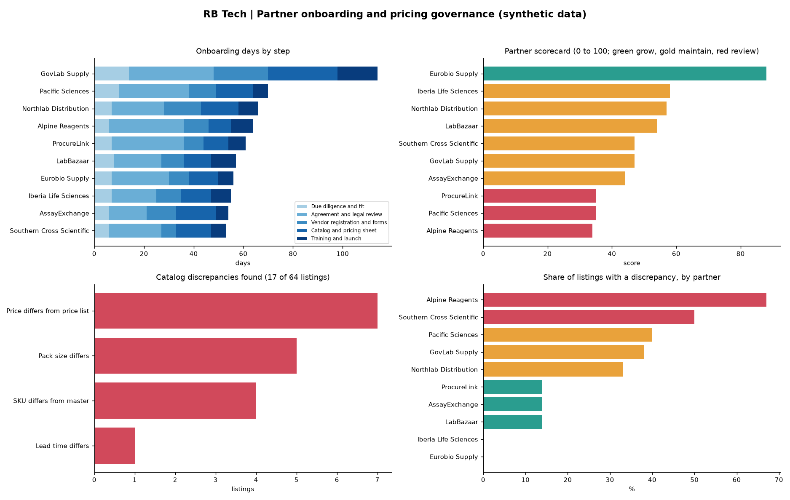

# 14 | Partner Onboarding and Pricing Governance

**Fictional company:** RB Tech · **All data is synthetic** · Partners are invented



## The problem
Channel growth meant more partners, each with its own forms, price sheets and catalog data. Onboarding took months with no view of where time went, and the same product appeared with different SKUs, prices, pack sizes and lead times on different partners' sites. Buyers saw the mismatch before the company did.

## What I built
1. **A five-step onboarding process** with a time measure per step: due diligence, agreement, vendor registration, catalog and pricing sheet, training and launch ([docs/onboarding_checklist.md](docs/onboarding_checklist.md)).
2. **A partner scorecard** combining revenue, sell-through, catalog accuracy, order errors and response time, with three tiers: grow, maintain, review ([docs/partner_scorecard.md](docs/partner_scorecard.md)).
3. **A pricing and catalog standard**: one master sheet is the source of truth for SKU, price, pack size and lead time; each partner's sheet follows that partner's own format guide ([docs/pricing_sheet_standard.md](docs/pricing_sheet_standard.md)).
4. **A catalog audit** that compares every partner listing with the master and lists each mismatch for correction. This extends the duplicate-listing check in [project 04](../04-channel-sales) from one marketplace to every partner.

## What the synthetic data shows (ten partners, 64 listings)
| Finding | Evidence |
|---|---|
| Government marketplaces take about twice as long | The slowest onboarding is 114 days against 53 to 70 for distributors and commercial marketplaces; agreement review (about 24 days on average) and the catalog sheet (14 days) are the longest steps |
| One in four listings does not match the master | 17 of 64 listings (27%) differ in price, pack size, SKU or lead time |
| Price is the most common mismatch | Seven price differences, five pack-size, four SKU and one lead-time difference |
| One partner stands out | One distributor scores 88 against 34 to 58 for the rest; three partners fall into the review tier |
| Errors cluster by partner | Three partners account for 10 of the 17 mismatches, so fixes are targeted, not general |

## How the data is used
- **Onboarding:** each new partner has a checklist, an owner and a target of 60 days.
- **Monthly catalog audit:** mismatches go to the partner and to the product data owner with a due date.
- **Quarterly partner review:** scores decide where to invest in training, joint marketing or price support, and which partners to move to review.

## Design decisions
1. **One master sheet.** Partner sheets are derived from it, never edited independently.
2. **Operations-owned fields stay with operations.** Commercial operations fills price, units and lead time; trade codes come from the logistics owner.
3. **Read each partner's own guidelines first**, then fill fields in the format the partner expects.
4. **Audit across partners, not within one.** A mismatch is only visible when partners are compared.
5. **Score on outcomes**, not on volume alone, so a small accurate partner is not penalised.

## Documents and diagrams
- [docs/onboarding_checklist.md](docs/onboarding_checklist.md) · [docs/partner_scorecard.md](docs/partner_scorecard.md) · [docs/pricing_sheet_standard.md](docs/pricing_sheet_standard.md)
- [diagrams/onboarding_flow.md](diagrams/onboarding_flow.md)

## Added case
- **Marketplace listing requirements and RFI response kit:** a per-platform checklist and a reusable answer library. See [docs/marketplace_listing_requirements_and_rfi.md](docs/marketplace_listing_requirements_and_rfi.md).

## Reproduce
```bash
pip install pandas numpy matplotlib
python scripts/partner_program.py    # writes data/*.csv and charts/partner_program_dashboard.png
```

## Skills shown
Channel and partner operations · onboarding process design · partner performance scoring · pricing and catalog governance · cross-source data audit · Python
