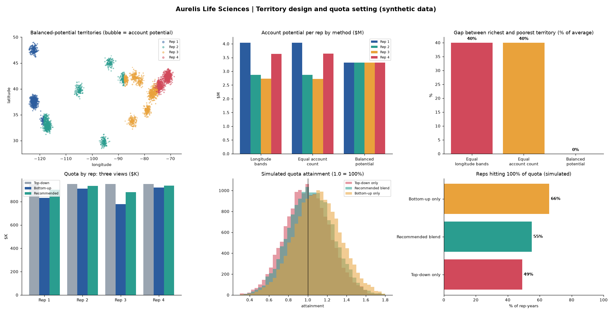
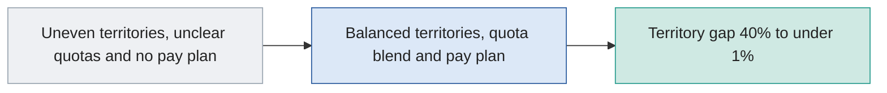
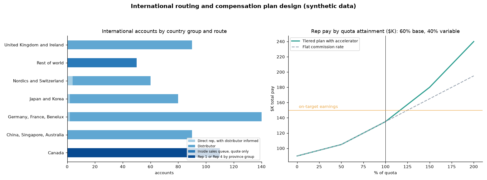

# 15 | Territory Design, Quota Setting and Compensation Plan

**Fictional company:** RB Tech · **All data is synthetic** · Compensation figures are illustrative best-practice values



## At a glance


## The story in STAR
- **Starting point:** Built from scratch: there was no usable history, so the first version rests on stated assumptions, each one labelled and replaced by actual data as it builds up.
- **Situation:** Territories were drawn by geography, quotas came from the revenue target, and there was no pay plan.
- **Task:** Create fair territories, realistic quotas and a pay plan.
- **Action:** Balanced territories by buying potential, routed international leads by country group, blended top-down and bottom-up quotas, simulated attainment and designed the pay plan.
- **Result:** The gap between the richest and poorest territory fell from 40% to under 1%, and the share of reps reaching quota rose from 49% to 55%.

## The problem
Reps had territories drawn by geography alone, quotas handed down from the revenue target, and no written pay plan. One rep's patch held far more buying potential than another's, the company target was higher than the reps' own pipeline supported, and international leads from web forms and trade shows had no clear owner.

**Planning scale:** the quotas and pay figures below describe a growth-plan year, after distributors and OEM partners are live, not the current year's revenue. They show how the method scales.

## What I did
1. **Divided territory by potential, not by map.** I scored every target account by segment and research-hub density, then cut territories west to east so each rep holds the same total potential and whole metro areas stay together ([docs/territory_design.md](docs/territory_design.md)).
2. **Routed international leads by country group.** I used an AI assistant to classify international leads by country and rank them by potential, then applied one written rule set: Canada to the nearest rep, Europe and Asia-Pacific to distributors, large accounts to a direct rep with the distributor informed, and the rest to an inside-sales queue for quotes ([docs/territory_design.md](docs/territory_design.md)).
3. **Set quotas top-down and bottom-up, then blended.** The company target is split by territory potential; a bottom-up estimate adds expansion from current customers, pipeline times win rate, and new-account capacity; the recommended quota is a 60/40 blend, tested by simulation ([docs/quota_setting.md](docs/quota_setting.md)).
4. **Wrote a compensation plan from best practice**: 60/40 base to variable, a commission rate tied to quota, a lower rate for the first half of quota, accelerators above 100%, and clear rules ([docs/compensation_plan.md](docs/compensation_plan.md)).



## What the synthetic data shows (3,200 domestic accounts, 620 international)
| Finding | Evidence |
|---|---|
| Equal account counts hide unequal potential | Splitting by longitude or by account count leaves the richest territory about 40% above the poorest; splitting by potential brings the gap to under 1% |
| Fair territories do not have equal account counts | Under the potential-based split, accounts per rep range from 626 to 977 |
| The top-down target is above capacity | Company target $3.80M against a bottom-up estimate of $3.44M; the blended quotas total $3.66M |
| The blend sets a fairer bar | Simulated share of reps reaching 100%: 49% on top-down quotas, 55% on the blend, 66% on bottom-up only; a common guide is 55% to 70% |
| The pay plan stays affordable | Simulated cost of sales (pay divided by revenue) is about 15% at these assumptions |
| International leads each have an owner | Distributors take most of Europe and Asia-Pacific; eight large accounts go to a direct rep with the distributor informed |

## Design decisions
1. **Balance potential, keep metros whole.** Reps own complete research hubs so they can plan travel and local events.
2. **Quotas follow capacity.** A quota the pipeline cannot support only creates missed targets and turnover.
3. **Pay for the behaviour the company wants.** The variable share and accelerators reward attainment, and the rule against paying twice on partner deals protects margin.
4. **Write rules once.** Territory, routing, quota and pay rules live in documents so they survive staff changes.
5. **Review each year, adjust mid-year only for real change** such as a new product, partner or hire.

## Related projects
- **Lead and account ownership rules, lanes and ticket routing** are in [project 09](../09-sales-model-and-lead-ownership). This project covers how territories are balanced, how international leads are routed, and quota and pay.
- **Pipeline coverage** used in quota checks is defined in [project 11](../11-pipeline-health-analysis).

## Documents
- [docs/territory_design.md](docs/territory_design.md) · [docs/quota_setting.md](docs/quota_setting.md) · [docs/compensation_plan.md](docs/compensation_plan.md)
- [diagrams/territory_quota_flow.md](diagrams/territory_quota_flow.md)

## Reproduce
```bash
pip install pandas numpy matplotlib
python scripts/territory_quota.py    # writes data/*.csv and both charts
```

## Skills shown
Territory design and balancing · lead routing rules · AI-assisted classification · quota setting and capacity planning · simulation of attainment · sales compensation design · Python
