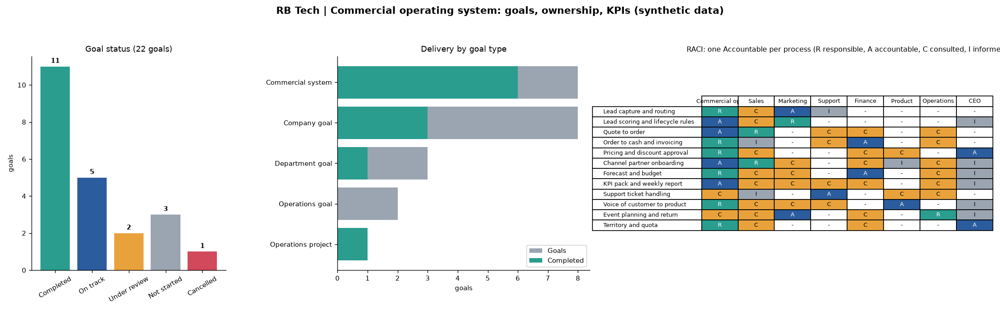

# 16 | Commercial Operating System: Goal Tracker, RACI Matrix and KPI Dictionary

**Fictional company:** RB Tech · **All data is synthetic**



## The problem
Company goals, department goals and commercial projects lived in different lists, so nobody could see which projects served which goal or what was late. Ownership of processes such as pricing approval or lead routing was unclear, and the same KPI (revenue, orders, opportunities) was calculated differently in the CRM, the accounting system and the reports. Executives were handed numbers that did not agree.

## What I built
1. **A goal and project tracker** that links each company goal to department goals and commercial projects, with priority, lead, due quarter and status ([docs/goal_tracker_rules.md](docs/goal_tracker_rules.md)).
2. **A RACI matrix** for twelve commercial processes with exactly one accountable role for each, checked by the script ([docs/raci_rules.md](docs/raci_rules.md)).
3. **A KPI dictionary**: for each of twelve KPIs, the definition, the source of truth, the owner, the cadence and a note on how it is counted ([data/kpi_dictionary.csv](data/kpi_dictionary.csv)).
4. **An executive KPI pack layout**: seven pages, each with a defined visual and source, so a mock-up can be turned into the real dashboard without argument about numbers.
5. **An operating rhythm**: weekly pipeline and ticket review, monthly KPI pack and goal review, quarterly plan review ([diagrams/operating_rhythm.md](diagrams/operating_rhythm.md)).

## What the synthetic data shows (22 goals and projects)
| Finding | Evidence |
|---|---|
| Commercial systems delivered best | 6 of 8 commercial-system projects completed, with one cancelled pending a finance hire |
| Company-level goals move more slowly | 3 of 8 company goals completed, 4 more on track or under review |
| Every process has one owner | 12 of 12 processes have exactly one accountable role |
| KPIs have one source of truth | Revenue comes from the accounting system, not CRM deal amounts; orders include no-charge orders; opportunities are counted, not valued |
| Cancelled work is visible | A cancelled project is shown with its reason and the condition for restarting it |

## How it is used
- **Weekly:** the tracker and the pipeline report are reviewed in the commercial meeting.
- **Monthly:** the KPI pack goes to leadership; any KPI whose definition changed is flagged.
- **Quarterly:** goals are re-rated and the plan for the next quarter is agreed.
- **New hires and new projects:** the RACI and the KPI dictionary answer "who owns this" and "what does this number mean".

## Design decisions
1. **One accountable role per process.** Two owners means none.
2. **One source of truth per KPI**, written down. Money comes from the accounting system; counts come from the CRM or order system.
3. **Count, not value, where the question is activity.** Orders and opportunities are shown as counts; value appears in revenue.
4. **Show cancelled and deferred work**, with a reason, instead of deleting it.
5. **Tables for ranked lists**, charts for trends, so the pack reads quickly.

## Documents
- [docs/goal_tracker_rules.md](docs/goal_tracker_rules.md) · [docs/raci_rules.md](docs/raci_rules.md)
- [diagrams/operating_rhythm.md](diagrams/operating_rhythm.md)
- Data: [goal_tracker.csv](data/goal_tracker.csv) · [raci_matrix.csv](data/raci_matrix.csv) · [kpi_dictionary.csv](data/kpi_dictionary.csv) · [kpi_pack_layout.csv](data/kpi_pack_layout.csv)

## Reproduce
```bash
pip install pandas numpy matplotlib
python scripts/operating_system.py    # writes data/*.csv and charts/operating_system_dashboard.png
```

## Skills shown
Goal and project portfolio management · RACI design · KPI definition and metric governance · executive reporting design · operating cadence · cross-functional alignment · Python
