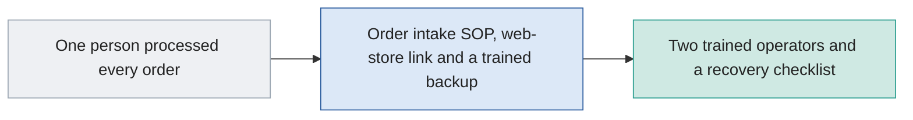

# 17 | Order Fulfillment and ERP Rollout

**Fictional company:** RB Tech · **All content is synthetic** · No real systems, customers or products are named

## At a glance

## The story in STAR
- **Starting point:** Built from scratch: there was no usable history, so the first version rests on stated assumptions, each one labelled and replaced by actual data as it builds up.
- **Situation:** One person processed every order, and a system outage lost settings.
- **Task:** Document the order process, add a trained backup and prepare for outages.
- **Action:** Wrote the email-intake and PO procedure, linked the web store to the ERP, recorded training, trained a second operator and documented outage recovery.
- **Result:** Two people can run an order end to end, with a written procedure and a recovery checklist.

## The problem
Orders reached the company by email, purchase order and web store, and one person knew how to turn them into shipments. Orders were keyed by hand into spreadsheets, stock and customer data were not in one place, and when that person was away the process slowed or stopped.

## What I built
An order workflow on an ERP and materials-planning system for a small life-science company ([diagram](diagrams/order_workflow.md)):
1. **Sales-order email intake.** A shared order mailbox with a standard subject line and a template, so every order creates one sales order with the same fields ([docs/order_intake_and_integration.md](docs/order_intake_and_integration.md)).
2. **Purchase-order processing SOP.** A step-by-step procedure from receiving a customer PO to confirming the shipment, with checks for customer, price, ship-to, tax status and stock ([docs/po_processing_sop.md](docs/po_processing_sop.md)).
3. **Web store to ERP integration.** Web orders create sales orders in the ERP automatically; stock levels and shipment status flow back to the store ([docs/order_intake_and_integration.md](docs/order_intake_and_integration.md)).
4. **Training video and written guide.** A recorded walkthrough of the full order process, kept next to the SOP so new staff can learn without a live session.
5. **A trained backup operator.** A second person who has run live orders, with a one-page handover, so the process no longer depends on one person ([docs/backup_operator_and_training.md](docs/backup_operator_and_training.md)).
6. **Outage recovery notes.** After a system outage the ERP came back without some of its settings; the recovery steps and the lessons are written down ([docs/outage_recovery_lessons.md](docs/outage_recovery_lessons.md)).

## Deal entry, quotes and order flow
- **Deal entry standards:** required fields on every deal, the one rule on products, deal value without shipping or tax, when to mark closed won, sample orders, closed-lost timing, revenue estimates, close dates and the custom project pipeline ([docs/deal_entry_and_order_flow.md](docs/deal_entry_and_order_flow.md)).
- **Order to invoice in six steps:** closed won, order entry, confirmation, documents, shipment, then invoice only after shipping.
- **Quote process:** steps and best practices for creating quotes in the CRM ([docs/quote_process.md](docs/quote_process.md)).

## Results (illustrative)
| Measure | Before | After |
|---|---|---|
| Orders entered by hand into spreadsheets | Most | Web orders: none; email orders: one standard entry |
| People able to process an order end to end | 1 | 2 |
| Written procedure and training | None | SOP, checklist and video |
| Recovery after an outage | Improvised | Documented checklist with a settings export |

## Lessons
1. **Build in buffer for vendor instability.** A new system and its vendor will have outages and changes of support; plan extra time and keep a manual fallback.
2. **Document first.** Write the process before configuring the system, so the system follows a process people agree on.
3. **Remove single points of failure early**, with a trained backup and a recording.
4. **Export settings regularly.** Configuration is data and needs backups like any other data.

## Related projects
[Commercial systems architecture](../07-commercial-systems-architecture) · [Channel sales](../04-channel-sales) · [Shipping cost simulation](../05-shipping-cost-simulation)

## Skills shown
ERP and order-to-cash process design · SOP writing · system integration requirements · business continuity and cross-training · change management and training · vendor risk planning
