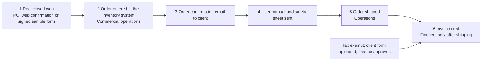

# Deal entry standards and the sales-order-to-invoice flow

## Required on every deal
| Field | Rule |
|---|---|
| Pipeline | Choose Catalogue products, Custom projects or Free samples correctly; each has its own stages, and the choice drives all downstream reporting |
| Free sample property | Flag it whenever any line item is given away as a sample |
| Next steps | Always filled in and kept current |
| Contact association | Mandatory: every deal is associated with a contact |
| Company association | Verify the deal is linked to the right company, not a duplicate |
| Deal source | Always capture where the deal came from |
| Product line items | Must match the catalog |
| Closed lost reason | The owner adds the reason whenever a deal is closed lost, so leadership gets clear answers |

**One hard rule on products:** nobody adds a beta, custom or one-off product directly in a deal. It breaks product reporting and revenue tracking. The request goes to the product data owner, who adds it to the catalog; after that it syncs and can be selected normally.

**Deal value is product value only.** Shipping and tax never go in the deal amount. Example: 2 vials at $100 is a $200 deal. Shipping and tax appear later, from the accounting system at invoicing.

**Other habits:** check for an existing company or contact before creating one; select line items from the catalog, never hand-type names; double-check the pipeline (catalogue, custom or free sample); when in doubt about a new or beta product, pause and ask.

## When to mark a deal closed won
Any one of these is enough, and the deal is marked at that moment, not at shipment:
1. A signed client PO received directly.
2. An e-commerce order confirmation arrives in the sales mailbox.
3. A signed sample request form for a non-animal-model sample, ready to ship.
4. Written client confirmation for a general free sample.
Operations then picks up order entry and shipping.

## Sales-order-to-invoice flow

**Invoice goes out after shipping, not before.** The most common confusion is a rep asking for an invoice on an order that has not shipped.

## Product catalog sync
A new product launched on the website flows one way into the product data hub and then into the CRM once commercial operations or marketing verify it. Nobody creates a launched product in the CRM by hand; a missing product is reported to commercial operations or marketing.

## Sample orders (non-revenue pipeline)
- Trigger for the non-animal-model samples: the signed sample form; for general free samples: written client confirmation. Create the deal if none exists and tell the team in chat first so nobody duplicates it.
- Deal setup: Free samples pipeline, free sample property set to the sample type, correct product and quantity, project title and institution or assay details in the description, contact and company associated.
- Limits: inside the US one sample ships with shipping waived; outside the US and Canada, quantity and shipping cost need executive approval; the standard cap is two vials or one kit, and anything above needs approval.
- After closing, the rep collects shipping and billing details and a delivery phone number directly from the client; commercial operations creates the order and sends the confirmation with sample terms; operations ships; finance invoices after shipment (a quotation is optional unless the client asks).

## When to mark a deal closed lost
- Recommendation: closed lost after about 50 days with no progress.
- Average days to close, closed-won: roughly 41 in the catalogue pipeline and 74 in the free-samples pipeline, so one flat rule may not fit both.
- Decision in force: an automated email goes to the deal owner when a catalogue or free-sample deal has no activity for 60 consecutive days, and the owner decides to progress or close it.

## Deal naming
`Company Deal# - Product`, with a deal number only when a company has several deals. Partnership deals split into short, mid and long term revenue use Roman numerals. Custom projects use deposit and milestone names agreed with leadership.

## Revenue estimates and close dates
| Deal type | Estimate rule |
|---|---|
| Product purchase, quantity known | List price multiplied by quantity (less discount) |
| Product known, quantity unknown | Value of one unit at list price |
| New cell program | 80% of the proposed terms, for one quarter before the project starts, extended as the project runs |
| Partnership upfront fee or milestone | 80% of the proposed terms; one deal per fee or milestone; high-priority deals appear in board reports |
| Royalties | Never entered in the CRM |
| Close date | Prefer a date the customer gave; otherwise best estimate; default three months from deal creation for product sales |

## Custom project pipeline
Used for complex partnership and custom-differentiation deals, to understand sales cycle, cash flow and milestone follow-up.
- Create a **deposit** deal when the project is technically feasible and the lab team approves the scope.
- When the contract is signed, create all **milestone** deals at once so forecasting is accurate.
- If the project is not feasible or the client has no budget, create no deal: record the interest in the voice-of-customer pipeline and set a task to revisit.

| Stage | When to use | Probability |
|---|---|---|
| Discovery and scoping | Initial technical discussions | 10% |
| Contract or proposal sent | Scientific proposal and quote with the client | 20% |
| Negotiation | Contract or price discussion | 25% |
| Contract signed | Signed, no work started, no cash yet | 40% |
| Upfront payment received | Cash in; project green-lit | 50% |
| Project on hold | Delay on either side | 55% |
| In progress (milestone pending) | Milestone work underway | 70% |
| Milestone achieved or invoicing | Goal met, invoice sent | 100% |
| Project cancelled | Project or milestone ended | 0% |
