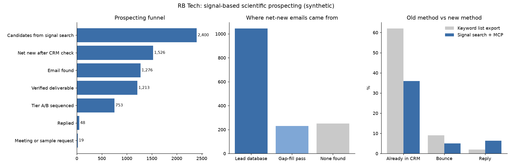

# 18 | AI-Assisted Scientific Prospecting: Lead Database + Claude over MCP

**Fictional company:** Aurelis Life Sciences · **All data is synthetic** · Researchers and organisations are generated



## The problem
Prospecting for a research-cell product line ran on keyword list exports from a scientific lead database. About six in ten exported contacts were already in the CRM, because reps and marketing email blasts had worked them before. Many leads had no email, the emails that came back were matched to the master files by hand, and nothing explained why a researcher was worth contacting *now*. Sales wanted net-new leads with a reason to buy, not longer lists.

## What I built
I connected the lead database to an AI assistant (Claude) through **MCP (Model Context Protocol)**. The assistant searches, reads and enriches records directly, and Python scripts handle the bulk work on large files. A person stays in charge of every write and every send.

```mermaid
flowchart LR
    subgraph S[1 Signal search]
      Q[Plain-language request<br>persona + product fit] --> MCP[Claude queries the lead<br>database over MCP]
      MCP --> SIG[Signals: new grants, recent papers,<br>clinical trials, posters, new labs]
    end
    subgraph C[2 Clean and qualify]
      SUP[CRM suppression check<br>email, name + org, profile handle]
      INT[Researcher intel<br>why-now note per lead]
      TIER[Fit score and tiers A / B / C]
    end
    subgraph E[3 Contact data]
      GAP[Email gap-fill<br>stable Lead ID upload and merge]
      VER[Email verification]
    end
    subgraph O[4 Outreach]
      DRAFT[Personalised first-email drafts<br>reviewed by a person]
      CRM[(CRM import with lead-source tag<br>sequences sent from the CRM)]
    end
    SIG --> SUP --> INT --> TIER --> GAP --> VER --> DRAFT --> CRM
    CRM -.->|replies, meetings| MEAS[Measure against the old method]
```



1. **Signal search.** The assistant turns a plain-language request ("vascular biology labs with a new grant this year") into database filters, refines the search and pulls researchers together with the signal behind each one: a grant, a paper, a trial, a poster or a new lab.
2. **CRM suppression first.** Every candidate is checked against a CRM export on email, a normalised name + organisation key and the profile handle before any enrichment credit is spent. New people at accounts a rep already owns go to that rep instead of cold outreach.
3. **Researcher intel.** For each remaining lead the assistant reads the profile, grants and recent publications and writes a one-line *why now* note.
4. **Tiering.** A fit score combines segment, persona match and signal recency. The top 25% become tier A, the next 40% tier B, the rest tier C.
5. **Email gap-fill and bulk updates.** Leads without an email go to the database in one upload file keyed by a stable Lead ID (a hash of the person and organisation). Results merge back into the master files in place, so manual edits are kept. Scripts stop if a row has changed since the upload, and every lead still missing an email goes on a separate list. No lead is deleted.
6. **Verification.** Every email is verified before import; bounced addresses are dropped.
7. **Outreach.** The assistant drafts a first email per lead from its signal. A person reviews it, and sequences are sent only from the CRM, tagged by lead source so results can be measured.

Detail: [diagrams/workflow.md](diagrams/workflow.md) · [docs/guardrails.md](docs/guardrails.md)

## What the synthetic run shows (2,400 candidates)
| Stage | Count |
|---|---|
| Candidates from signal search | 2,400 |
| Net new after the CRM check | 1,526 (36% already in the CRM) |
| Email found (database 1,045 + gap-fill 231) | 1,276 |
| Verified deliverable | 1,213 |
| Tier A/B sequenced | 753 |
| Replied | 48 (6.4%) |
| Meeting or sample request | 19 |

| Metric | Keyword list export | Signal search + MCP |
|---|---|---|
| Share of list already in the CRM | 62% | 36% |
| Email coverage on net-new leads | 55% | 84% |
| Bounce rate after verification | 9% | 5% |
| Analyst hours per 100 ready leads | 6.0 | 1.5 |
| Reply rate on sequenced leads | 2% | 6.4% |

Tier A replies at about 8% against about 5.5% for tier B, so the score sorts leads in the right order. The numbers are simulated; the method is the point.

## Design decisions
1. **Suppress before you enrich.** Checking the CRM first means credits are spent only on people nobody has contacted.
2. **One stable key per lead.** A hashed Lead ID lets results from any tool map back to the right row, even when names are written differently.
3. **The AI reads; people decide.** The assistant searches, enriches and drafts. It never writes to the CRM or sends email.
4. **Bulk work goes in scripts, not chat.** Large files are updated by repeatable scripts with checks, so a run can be repeated and audited.
5. **A signal behind every lead.** Each lead carries a reason to contact it now, which drives both the tier and the first line of the email.
6. **Measure against the old way** on the same metrics: overlap with the CRM, bounce rate, replies, meetings and cost per meeting.

## Where it fits
This project is the tool layer for the method in [GTM-Strategy 04, net-new lead generation pilot](https://github.com/rbanola1/GTM-Strategy/tree/main/04-net-new-lead-gen-pilot) (suppress first, tier first, enrich last) and the signal logic in [GTM-Strategy 01](https://github.com/rbanola1/GTM-Strategy/tree/main/01-outbound-gtm-engine). It shows how an AI assistant over MCP carries out those steps; the budget and credit model is in GTM 04.

This is the lead-generation layer of the lead-to-cash architecture in [project 07](../07-commercial-systems-architecture), and it applies the suppress-first, tier-first rules of the net-new pilot in [GTM-Strategy](https://github.com/rbanola1/GTM-Strategy).

Tools behind the roles: a scientific lead database, an AI assistant (Claude) connected over MCP, a CRM, and an email verifier.

## Reproduce
```bash
pip install pandas numpy matplotlib
python scripts/signal_prospecting.py    # writes data/*.csv and charts/prospecting_dashboard.png
```

## Skills shown
AI-assisted prospecting · MCP tool integration · signal-based targeting · data enrichment at scale · bulk data updates with audit checks · CRM suppression and deduplication · lead scoring and tiering · personalised outreach · Python
