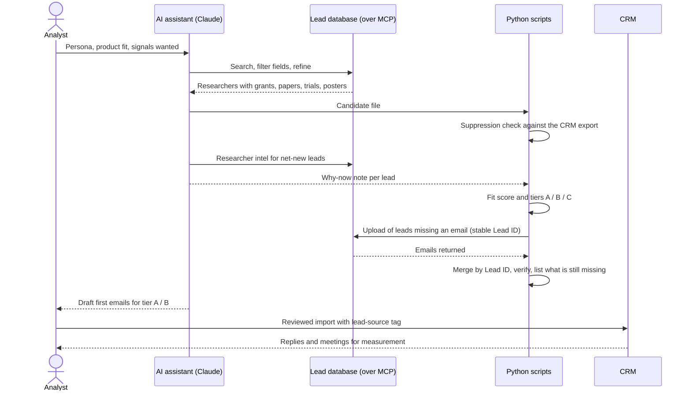
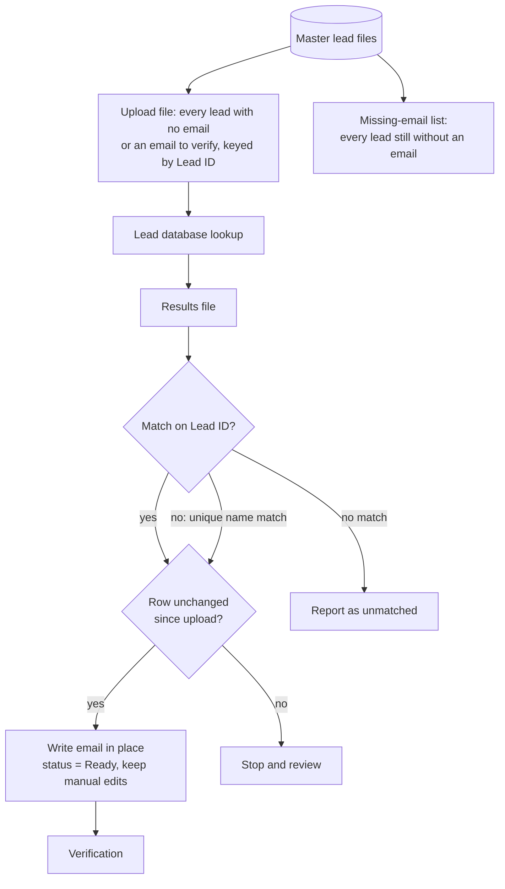

# Workflow

## Who does what

## Email gap-fill and bulk update

No lead is removed by the merge. An old unverified email that the database cannot confirm is cleared, and the lead moves to the missing list.
